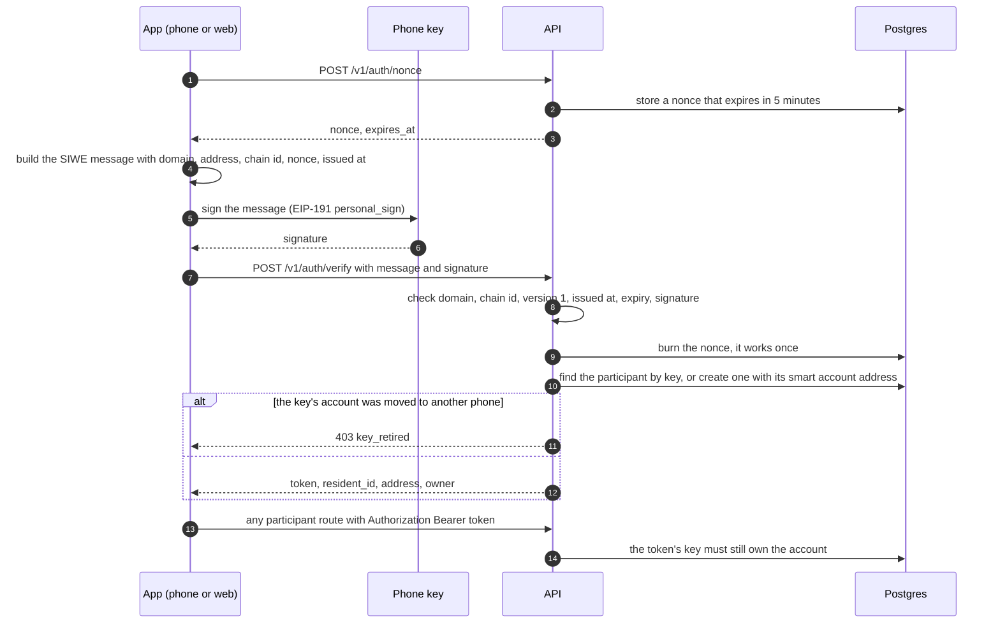
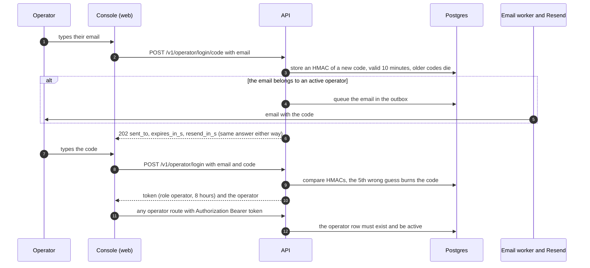

# Zyrcle API

The reference for engineers who call the Zyrcle backend or change it. It covers every route the
FastAPI app in [`apps/api`](../apps/api/README.md) mounts, how callers sign in, the live WebSocket,
the error format and the rules that make retries safe.

The code is the source of truth. This file was written from the router modules
([`api.py`](../apps/api/src/zyrcle_api/api.py), [`public.py`](../apps/api/src/zyrcle_api/public.py),
[`booking_routes.py`](../apps/api/src/zyrcle_api/booking_routes.py),
[`account_routes.py`](../apps/api/src/zyrcle_api/account_routes.py),
[`collection_routes.py`](../apps/api/src/zyrcle_api/collection_routes.py),
[`sale_routes.py`](../apps/api/src/zyrcle_api/sale_routes.py),
[`operator_auth.py`](../apps/api/src/zyrcle_api/operator_auth.py),
[`demo.py`](../apps/api/src/zyrcle_api/demo.py)), the services they call, and the tests in
[`apps/api/tests`](../apps/api/tests). If you find a difference, the code wins: fix this file in the
same commit ([ADR 0025](adr/0025-documentation-as-code.md)).

Words used below:

| Word | Meaning |
|---|---|
| Participant | A person who recycles. The code calls them a *resident* (`resident_id`, `role: resident`). |
| Collector | A participant the operator named to empty containers into bags ([ADR 0012](adr/0012-collection-and-bags.md)). |
| Operator | A person who runs Zyrcle from the console (`/console` in the web app) ([ADR 0014](adr/0014-operator-accounts.md)). |
| Admin | An operator with `role: admin`. Only admins manage other operators. |
| Host, site | A host is an institution (a university). A site is a place it runs (a campus). Containers belong to a site ([ADR 0011](adr/0011-hosts-and-sites.md)). |
| Container | The smart bin. It talks to the backend over MQTT, never over HTTP. |
| Phone key | The private key the app keeps on the phone. It signs the sign-in message. |
| Smart account | The on-chain account that holds a participant's ZYR. The phone key controls it ([ADR 0010](adr/0010-smart-accounts-and-recovery.md)). |
| JWT | JSON Web Token: a signed string the API hands out at sign-in and expects back on every call. |
| Advance | What a verified deposit is paid right away, before its material is sold ([ADR 0003](adr/0003-advance-and-settlement.md)). |
| Turn, slot | One local hour at one container. Participants can book one ahead ([ADR 0009](adr/0009-time-slots.md)). |

---

## 1. Overview

### Base URLs

| Environment | API base URL | Where it is set |
|---|---|---|
| Production | `https://zyrcle-backend.deviego.xyz` | [`deploy/README.md`](../deploy/README.md), `API_HOST` in [`deploy/.env.example`](../deploy/.env.example), default `API_URL` in [`apps/mobile/src/lib/config.ts`](../apps/mobile/src/lib/config.ts) |
| Local | `http://127.0.0.1:8000` | `zyrcle-api serve` defaults ([`cli.py`](../apps/api/src/zyrcle_api/cli.py)), default `VITE_API_URL` in [`apps/web/src/lib/config.ts`](../apps/web/src/lib/config.ts) |

The production web app is `https://zyrcle.deviego.xyz`. That host matters to the API twice: it is
the Sign-In with Ethereum domain (`ZYRCLE_SIWE_DOMAIN` is set to `WEB_HOST` in
[`deploy/compose.yml`](../deploy/compose.yml)) and the only allowed browser origin
(`ZYRCLE_CORS_ORIGINS`).

The WebSocket uses the same host with `ws://` or `wss://`. The shared client builds it by replacing
`http` with `ws` in the base URL ([`packages/client/src/api.ts`](../packages/client/src/api.ts),
`liveUrl`).

Who calls the API:

| Client | Code | Calls |
|---|---|---|
| Web app (`apps/web`) and Expo app (`apps/mobile`) | the shared client [`packages/client/src/api.ts`](../packages/client/src/api.ts) | public, participant, collector and demo routes |
| Operator console (`apps/web`, `/console`) | [`apps/web/src/console/api.ts`](../apps/web/src/console/api.ts) | `/v1/operator/*` |
| Containers | MQTT only, see [device-protocol.md](device-protocol.md) | no HTTP; operators register them with `POST /v1/operator/devices` |
| Deploy scripts, seed, tests | the shared operator token | `/v1/operator/*` |

### Versioning

Every route lives under `/v1`, except `GET /health` and FastAPI's own docs pages (section 6). There
is no version header and no content negotiation. The `version="0.1.0"` passed to `FastAPI(...)` in
[`main.py`](../apps/api/src/zyrcle_api/main.py) only shows up in the OpenAPI document.

Breaking changes are avoided by keeping old names as aliases until installed apps stop using them.
The only aliases today are the `residence` ones (section 3.2, [ADR 0011](adr/0011-hosts-and-sites.md)).

### JSON conventions

Requests and responses are JSON (`Content-Type: application/json`).

| Kind | Convention | Exceptions |
|---|---|---|
| Weight | integer grams, fields end in `_g` | public dashboards also give kilograms as decimals rounded to 3 places: `kg_verified`, `weight_kg`, `activity[].kg` |
| Money | integer Colombian pesos (COP), fields end in `_cop` | `balance_cop` in `GET /v1/me` is a decimal number (on-chain wei divided by 10^18), or `null` |
| Price | integer COP per kilogram: `cop_per_kg` | none |
| Timestamps | ISO-8601 with an offset. Stored times come back in UTC (`+00:00`) | booking and slot times (`starts_at`, `ends_at`) are in the deployment's time zone (`ZYRCLE_TIMEZONE`, default `America/Bogota`, so `-05:00`) |
| Dates | `YYYY-MM-DD` (`day`, `days`, `sold_on`) | local days in the deployment's time zone |
| Addresses | lowercase `0x` hex, 40 characters. Inputs in any case are accepted and lowercased | `address` in `GET /v1/operator/treasury` is the checksummed (mixed-case) form web3 returns |
| Ids | UUID strings | containers and devices use slugs matching `^[a-z0-9-]{3,64}$` (`ctr-0001`); bags use an 8-character code (below) |
| Materials | one of `cardboard`, `glass`, `hdpe`, `metal`, `paper`, `pet` (`GET /v1/materials`) | none |

Two scanned codes appear in request bodies:

- **Container QR:** `zyrcle://c/<container-id>?code=<access-code>`. The container shows it on its
  screen. The access code rotates about every 30 seconds and a code works for at most 60 seconds
  ([`sessions.py`](../apps/api/src/zyrcle_api/sessions.py), `rotate_codes`).
- **Bag code:** 8 characters of Crockford base32 (`0-9` and `A-Z` without `I`, `L`, `O`, `U`). The
  printed QR is `zyrcle://b/<code>`. Every route that takes a bag accepts either form, in any case
  ([`collection.py`](../apps/api/src/zyrcle_api/collection.py), `parse_bag`).

### Errors

Domain errors use one shape: an HTTP status and a body with a stable `code` and an English
`detail` sentence.

```json
{"detail": {"code": "slot_full", "detail": "every spot of this hour is booked"}}
```

Branch on `code`, not on `detail`. The `detail` text is for logs and can change.

Two other shapes exist, and clients must handle all three. Both TypeScript clients read
`body.detail.detail ?? body.detail` for the message and `body.detail.code` for the code.

- **A plain string**, with no code: `{"detail": "missing bearer token"}`. Every 401, and a few
  operator-route checks, use it. The list is below the table.
- **FastAPI request validation**, status 422, when a body or query parameter breaks its model (a
  missing field, a string too long, `days=0`): `{"detail": [{"type", "loc", "msg", "input", ...}]}`.

Error codes ([`errors.py`](../apps/api/src/zyrcle_api/errors.py) plus the routes that write a code
by hand):

| `code` | HTTP | When |
|---|---|---|
| `not_found` | 404 | The thing does not exist, or it is not yours (a session, booking, collection, recovery or bag of someone else answers 404) |
| `forbidden` | 403 | The container's access code is wrong or expired; not a collector; a bag that belongs to another collector; cancelling a turn that was already used; an admin-only route called by a non-admin |
| `conflict` | 409 | The current state does not allow it: container offline, busy or being emptied; you already have an open session or collection; a state change the state machine refuses; a bag that is not sealed or has an open incident; an email that is already an operator; demoting yourself |
| `invalid` | 422 | A bad QR or bag code; a material the container does not take; booking-time rules; a bag listed twice in a sale |
| `unavailable` | 503 | The unlock command could not reach the container's broker |
| `closed` | 409 | The site is closed at that hour (deposit or booking). `detail` names the hours: `the container is open from 06:00 to 22:00` |
| `slot_full` | 409 | Every spot of the hour is taken |
| `already_booked` | 409 | You already booked that hour at that container |
| `too_many_bookings` | 409 | You already hold 3 upcoming bookings |
| `too_soon` | 429 | A code was sent to that address less than 60 seconds ago. `detail` says `wait N seconds ...` |
| `too_many_codes` | 429 | The daily code limit for that address (or participant) is reached |
| `code_invalid` | 422, or 401 on `POST /v1/operator/login` | Wrong, expired, used or never requested code. On participant routes `detail` ends in `N attempts left` |
| `invalid_email` | 422 | Not an email address |
| `email_taken` | 409 | Another participant already verified that email |
| `phone_in_use` | 409 | This phone already has deposits, bookings or an email, so it cannot receive another account |
| `recovery_pending` | 409 | This phone is waiting for an older account; it cannot deposit or book until the recovery ends |
| `recovery_in_progress` | 409 | This phone is already recovering a different account |
| `recovery_unavailable` | 503 | Email, or account recovery, is not configured on this server |
| `key_retired` | 403 | Sign-in only: this phone key's account was moved to another phone ([`api.py`](../apps/api/src/zyrcle_api/api.py), `verify`) |
| `amount_mismatch` | 422 | Confirming a sale with a received amount different from the ticket total ([`sale_routes.py`](../apps/api/src/zyrcle_api/sale_routes.py)) |
| `simulator` | the simulator's status (404, 409 or 422) | Demo routes only: the container simulator refused the request |

`errors.py` also defines `bad_request` (400) and `rate_limited` (429). They are base classes; no
route raises them directly today.

Errors that come back as a plain string, without a code:

| HTTP | `detail` | Where |
|---|---|---|
| 401 | `missing bearer token`, `invalid token`, `session ended: sign in again` | participant routes |
| 401 | the sign-in failure reason, for example `wrong domain`, `message expired`, `unknown, expired or already used nonce` | `POST /v1/auth/verify` |
| 401 | `missing bearer token`, `invalid operator token`, `this operator account is not active` | operator routes |
| 404 | `unknown resident` | `GET /v1/me` (not reachable in practice: the auth check fails first) |
| 409 | `device already registered` | `POST /v1/operator/devices` |
| 422 | the public-key parse error | `POST /v1/operator/devices` |
| 422 | `unknown materials: [...]`, `unknown material '...'` | `POST /v1/operator/containers`, `PUT /v1/operator/prices/{material}`, `POST /v1/operator/bags` |
| 503 | `chain is not configured` | `GET /v1/operator/treasury` |
| 503 | `could not create bags; try again` | `POST /v1/operator/bags` |

Anything else is a bug and comes back as a 500 (see Open questions for the known cases).

### Rate limits and quotas

**At the edge (production only).** Traefik puts the middleware `zyrcle-api-ratelimit` in front of
the API with `average=20` and `burst=60`
([`deploy/compose.yml`](../deploy/compose.yml)). Period and source are not set, so Traefik's
defaults apply (see Open questions). Over the limit, Traefik answers `429` with a plain-text body,
not the JSON error shape. There is no limit when you run the API locally.

**Per caller, in the app** ([ADR 0035](adr/0035-rate-limits.md),
[`ratelimit.py`](../apps/api/src/zyrcle_api/ratelimit.py)). Every request takes a token from a bucket
that refills steadily. Over the limit the API answers `429` with `{"code": "rate_limited"}` and a
`Retry-After` header, CORS headers included; the apps say "Vas muy rápido: espera unos segundos e
inténtalo de nuevo."

| Class | Routes | Counted by | Per minute |
|---|---|---|---|
| Emailed codes | `POST /v1/me/email`, `/v1/me/email/verify`, `/v1/recovery/code`, `/v1/recovery`, `/v1/operator/login/code`, `/v1/operator/login` | IP address | 20 |
| Phone sign-in | `POST /v1/auth/nonce`, `/v1/auth/verify` | IP address | 120 |
| Writes | other `POST`, `PUT`, `PATCH`, `DELETE` | account (a token whose signature checks), else IP address | 120 |
| Reads | other `GET` | account, else IP address | 600 |

`/health`, CORS preflights and the WebSocket are not limited. The IP address is the last entry of
`X-Forwarded-For`, the one Traefik added, so a client cannot choose it. The settings are
`ZYRCLE_RATE_LIMIT_*`.

**Per purpose, in the app.** These limits are enforced in code and apply everywhere:

| What | Limit | Error | Source |
|---|---|---|---|
| Participant email codes (recovery email and recovery) | 1 per 60 s and 5 per 24 h for each address and purpose; 10 per 24 h for each participant, whatever the addresses | `too_soon`, `too_many_codes` | [`email_codes.py`](../apps/api/src/zyrcle_api/email_codes.py) |
| Operator sign-in codes | 1 per 60 s and 10 per 24 h for each address | `too_soon`, `too_many_codes` | [`operator_auth.py`](../apps/api/src/zyrcle_api/operator_auth.py) |
| Wrong guesses of any email code | the 5th wrong guess burns the code | `code_invalid` | same |
| Code lifetime | 10 minutes | `code_invalid` | `CODE_TTL` in [`mail.py`](../apps/api/src/zyrcle_api/mail.py) |
| Sign-in nonce | single use, 5 minutes | 401 | [`auth.py`](../apps/api/src/zyrcle_api/auth.py) |
| Upcoming bookings | 3 per participant (booked ahead, not used yet); up to 7 days ahead, today included | `too_many_bookings`, `invalid` | [`domain/slots.py`](../apps/api/src/zyrcle_api/domain/slots.py) |

Asking for a code counts against the limits even when nothing is emailed, so the answer never
reveals whether an address belongs to someone.

### Timing callers see

Defaults from [`config.py`](../apps/api/src/zyrcle_api/config.py). Each one can be changed with an
environment variable named `ZYRCLE_` plus the setting's name in capitals.

| Setting | Default | Effect |
|---|---|---|
| `code_rotation_s` | 30 | The container's QR changes; a code works for at most 60 s |
| `unlock_ack_timeout_s` | 15 | A session or collection still `authorized` (lid never opened) expires |
| `idle_timeout_s` | 60 | An open deposit with no weight change closes by itself and is still credited |
| `measurement_timeout_s` | 20 | A deposit `closing` without a measurement becomes `failed` |
| `collection_idle_timeout_s` | 600 | An open collection with no activity closes by itself |
| `device_offline_after_s` | 90 | A container not heard from for this long is `online: false` |
| `jwt_ttl_minutes` | 1440 (24 h) | Participant token lifetime |
| `operator_jwt_ttl_minutes` | 480 (8 h) | Operator token lifetime |

### CORS

[`main.py`](../apps/api/src/zyrcle_api/main.py) adds CORS only when `ZYRCLE_CORS_ORIGINS` is set
(comma-separated). It allows those origins, the methods `GET POST PUT PATCH DELETE` and the headers
`Authorization` and `Content-Type`. It does not allow credentials (cookies); the API does not use
them. Production allows `https://zyrcle.deviego.xyz`. For the web app on your machine, set
`ZYRCLE_CORS_ORIGINS=http://localhost:8080` ([`apps/web/README.md`](../apps/web/README.md)). The
Expo app makes native requests and does not need CORS.

---

## 2. Authentication

There are two kinds of caller, with separate tokens. A participant token never works on an
operator route, and an operator token never works on a participant route
(`test_participant_and_operator_tokens_never_cross` in
[`test_operators.py`](../apps/api/tests/test_operators.py)).

**Header.** Every protected HTTP route reads `Authorization: Bearer <token>`. The prefix must be
exactly `Bearer ` (capital B, one space). A missing or different header gives
`401 missing bearer token`.

| Caller | Token | Lifetime | Get it from |
|---|---|---|---|
| Participant (and collector) | participant JWT, `role: resident` | 24 h | `POST /v1/auth/verify` |
| Operator, admin | operator JWT, `role: operator` | 8 h | `POST /v1/operator/login` |
| Machines (deploy, seed, tests) | the shared operator token, `ZYRCLE_OPERATOR_TOKEN` | until rotated | deployment secret |

There is no refresh endpoint. When a token expires, sign in again. The shared client's `isFresh`
([`packages/client/src/jwt.ts`](../packages/client/src/jwt.ts)) helps the apps avoid sending a token
that is about to expire; it reads the token but never verifies it.

### Participants: Sign-In with Ethereum

Sign-In with Ethereum (SIWE, [EIP-4361](https://eips.ethereum.org/EIPS/eip-4361)) is a standard
text message that a wallet signs to prove it holds a key. Here the wallet is the phone key. There is
no password ([ADR 0006](adr/0006-expo-mobile.md), [ADR 0010](adr/0010-smart-accounts-and-recovery.md)).



The message must match, byte for byte, what
[`auth.py`](../apps/api/src/zyrcle_api/auth.py) (`build_siwe`) and
[`packages/client/src/siwe.ts`](../packages/client/src/siwe.ts) (`buildSiweMessage`) produce. Lines
are joined with `\n`; lines 3 and 5 are empty. An example, with the production domain and chain:

```text
zyrcle.deviego.xyz wants you to sign in with your Ethereum account:
0x52908400098527886E0F7030069857D2E4169EE7

Sign in to Zyrcle.

URI: https://zyrcle.deviego.xyz
Version: 1
Chain ID: 20261121
Nonce: 3f9c2a7b8e1d4c6f0a5b9e2d7c4f1a8b
Issued At: 2026-11-22T15:04:05.000Z
```

The second line is the phone key's address, and the nonce is the one `POST /v1/auth/nonce` returned.

`POST /v1/auth/verify` accepts the message only if all of these hold:

- The first line's domain equals `ZYRCLE_SIWE_DOMAIN` (default `zyrcle.deviego.xyz`; `localhost` in
  [`apps/api/.env.example`](../apps/api/.env.example)).
- `Chain ID` equals `ZYRCLE_CHAIN_ID` (default `20261121`) and `Version` is `1`.
- `Issued At` carries a time zone and is no more than 2 minutes in the future and 5 minutes in the
  past. An optional `Expiration Time` must not have passed.
- The signature recovers to the address on the second line (compared in lowercase).
- The nonce exists, is unused and has not expired. It is burned in the same statement, so a second
  use of the message fails.

The `URI` line must be present, but the server does not check its value. The address is accepted
in any case (EIP-4361 asks for the checksummed form).

What the answer means:

- `owner` is the phone key, lowercase. `address` is where the participant's ZYR lives. With smart
  accounts on (`ZYRCLE_ACCOUNT_FACTORY_ADDRESS` set, plus the chain), it is the smart account's
  predicted address. Without them, `address` equals `owner`.
- A key seen for the first time creates a participant. When smart accounts are on, a participant
  from before them gets their account address on their next sign-in.

**Participant JWT claims** (HS256, signed with `ZYRCLE_JWT_SECRET`, [`auth.py`](../apps/api/src/zyrcle_api/auth.py) `issue_token`):

| Claim | Value |
|---|---|
| `sub` | the participant's id (UUID) |
| `addr` | the account address (where ZYR lives) |
| `key` | the phone key that signed in (lowercase) |
| `role` | `resident` |
| `iat`, `exp` | issued at and expiry, Unix seconds; `exp` is 24 h later by default |

**Every participant request** (`resident_dep` in [`deps.py`](../apps/api/src/zyrcle_api/deps.py)):

1. The token must decode with the secret, carry `exp` and `sub`, and have `role: resident`.
2. The participant must still exist.
3. If the token has a `key` claim, it must equal the account's current owner. Otherwise the answer
   is `401 session ended: sign in again`. Tokens from before smart accounts have no `key` and skip
   this check.

**The `key` claim and `key_retired`.** A lost-phone recovery hands the account to a new phone key
([ADR 0010](adr/0010-smart-accounts-and-recovery.md)). When it completes:

- the old phone's token fails step 3 at once (401);
- the new phone's temporary participant is folded into the account and deleted, so its token fails
  step 2 (401). The new phone signs in again and gets the old `resident_id`, balance and history;
- if the old phone ever signs in again, `POST /v1/auth/verify` answers `403 key_retired`.

### Operators: email code

Operators sign in with a six-digit code sent to their email ([ADR 0014](adr/0014-operator-accounts.md)).
Codes go out through the email outbox and Resend, so an operator cannot sign in on a server without
email configured (`ZYRCLE_RESEND_API_KEY`, or `ZYRCLE_EMAIL_LOG_ONLY` for local development). The
shared token still works there.



**Operator JWT claims** (HS256, same secret, `issue_operator_token` in
[`operator_auth.py`](../apps/api/src/zyrcle_api/operator_auth.py)): `sub` (the operator's id),
`role: operator`, `iat`, `exp` (8 h later by default).

**Every operator request** (`operator_who`): the bearer token is first compared, in constant time,
with the shared operator token. If it is not that, it must be an operator JWT whose operator row
exists and is `active`. Deactivating an operator ends their session on their next request.

**The shared operator token.** `ZYRCLE_OPERATOR_TOKEN` (24 characters at least) acts as an admin
named `token` with no operator id. Deploy scripts, the demo seed and the tests use it; people use
their own accounts. The first admin is added with it. Whatever an operator does is recorded with
their email, or `token` for the shared token (`reviewed_by`, `resolved_by`, `recorded_by`,
`confirmed_by`).

### WebSocket authentication

Browsers cannot set headers on a WebSocket, so the live socket takes the participant JWT in the
query string: `/v1/sessions/{session_id}/live?token=<JWT>`. Section 4 covers the checks.

### Who may call what

| Audience | Token | Extra condition |
|---|---|---|
| Public | none | none |
| Participant | participant JWT | none |
| Collector | participant JWT | an active collector row for that participant (only checked where noted) |
| Operator | operator JWT or shared token | operator is active |
| Admin | admin operator JWT or shared token | `role: admin` |

---

## 3. Endpoint reference

72 endpoints when demo mode is on: 71 HTTP operations and 1 WebSocket. Without demo mode, the 5
`/v1/demo` routes are not mounted. Success codes are 200 unless the table says otherwise.

The "Session", "Collection", "Bag", "Booking", "Recovery" and "Sale" objects that several routes
return are described once, after the routes that use them.

### 3.1 Health

| Method and path | Who | Returns |
|---|---|---|
| `GET /health` | public | `{"ok": true, "mqtt": <bool>}` |

It runs `select 1` on the database, so a database outage fails the request (500). `mqtt` says
whether the API's broker connection is up. The production compose health check calls it
([`deploy/compose.yml`](../deploy/compose.yml)).

### 3.2 Public

No token. These views never show an access code or anything that identifies a participant
([`public.py`](../apps/api/src/zyrcle_api/public.py)).

| Method and path | Returns | ADR |
|---|---|---|
| `GET /v1/materials` | the material list | [0005](adr/0005-device-link-mqtt.md) |
| `GET /v1/stats` | platform totals | [0011](adr/0011-hosts-and-sites.md) |
| `GET /v1/containers` | every container with its site and host | [0009](adr/0009-time-slots.md), [0011](adr/0011-hosts-and-sites.md) |
| `GET /v1/containers/{container_id}` | one container: what the app shows after a scan | [0011](adr/0011-hosts-and-sites.md) |
| `GET /v1/hosts` | every host with its sites | [0011](adr/0011-hosts-and-sites.md) |
| `GET /v1/sites` | every site with its host | [0011](adr/0011-hosts-and-sites.md) |
| `GET /v1/hosts/{host_id}/dashboard?days=` | a host's totals, each site's totals, daily series | [0011](adr/0011-hosts-and-sites.md) |
| `GET /v1/sites/{site_id}/dashboard?days=` | a site's totals, each container's state, daily series | [0011](adr/0011-hosts-and-sites.md) |
| `GET /v1/residences` **deprecated** | alias of `/v1/sites` in its old shape | [0011](adr/0011-hosts-and-sites.md) |
| `GET /v1/residences/{site_id}/dashboard?days=` **deprecated** | alias of the site dashboard | [0011](adr/0011-hosts-and-sites.md) |

**`GET /v1/materials`** returns `["cardboard", "glass", "hdpe", "metal", "paper", "pet"]`.

**`GET /v1/stats`** returns a Totals object:

| Field | Meaning |
|---|---|
| `containers` | number of containers |
| `deposits_verified` | deposits in state `verified` or `approved` |
| `kg_verified` | their weight, in kilograms (3 decimals) |
| `residents` | distinct participants with at least one such deposit |
| `payouts_confirmed`, `paid_cop` | advances confirmed on chain (count), and pesos paid in total: those advances plus what sales added on top of them (ADR 0013) |

**`GET /v1/containers`** returns a list ordered by host name, site name and container id. Each item:
`id`, `name`, `site_id`, `site_name`, `host_id`, `host_name`, `accepted_materials`, `online`,
`busy` (a deposit session is active on it), `last_seen_at`, plus the deprecated `residence_id` and
`residence_name`.

**`GET /v1/containers/{container_id}`** returns the same object for one container.
Errors: `404 not_found`.

**`GET /v1/hosts`** returns `[{id, name, kind, sites: [{id, name, containers}]}]`, where `kind` is
`university`, `residential`, `business` or `public` and `containers` is a count.

**`GET /v1/sites`** returns `[{id, name, host: {id, name, kind}, containers}]`.

**`GET /v1/hosts/{host_id}/dashboard`**

- Query: `days`, integer 1 to 90, default 14.
- Returns `{host, timezone, totals, sites: [{id, name, totals}], activity, payouts}`.
- Errors: `404 not_found`, FastAPI 422 for `days` out of range.

**`GET /v1/sites/{site_id}/dashboard`**

- Query: `days`, integer 1 to 90, default 14.
- Returns `{site, host, residence (deprecated, same as site), timezone, totals, containers, activity, payouts}`.
- Each container carries the public container fields plus `fill_pct` (0 to 100, from the latest
  closed lid, or `null`), `weight_kg` (the scale's last final reading), `deposits_verified`,
  `kg_verified`, `paid_cop` and `last_deposit_at`.
- Errors: `404 not_found`, FastAPI 422 for `days` out of range.

The daily series cover the last `days` local days, today included, in `ZYRCLE_TIMEZONE`:
`activity: [{day, kg: {<material>: <kg>}}]` (credited deposits by declared material) and
`payouts: [{day, cop}]` (confirmed advances).

#### Deprecated aliases

[ADR 0011](adr/0011-hosts-and-sites.md) renamed *residence* to *site* and added hosts. App builds
already installed read the old names, so they stay as aliases, marked `deprecated=True` in the code
(they show as deprecated in the OpenAPI docs):

| Old | New |
|---|---|
| `GET /v1/residences` → `[{id, name, containers}]` | `GET /v1/sites` |
| `GET /v1/residences/{id}/dashboard` | `GET /v1/sites/{id}/dashboard` (it calls the same function) |
| field `residence_id` on containers | `site_id` |
| field `residence_name` on containers, bookings and slots | `site_name` |
| field `residence` on the site dashboard | `site` |

Site ids are the old residence ids, so ids handed out earlier still work. New code must use the
site names. No code in `apps/web/src`, `apps/mobile` or `packages/client` reads the old names today.
Operator routes were renamed outright, because only Zyrcle's own tools call them.


#### Impact certificates (public)

[ADR 0027](adr/0027-impact-certificates.md), [`impact_routes.py`](../apps/api/src/zyrcle_api/impact_routes.py).

| Method and path | Returns |
|---|---|
| `GET /v1/hosts/{host_id}/certificates` | The host's certificates, newest month first: host, site, period, totals, `by_material`, `merkle_root`, `status`, `anchor_tx`, `ipfs_cid` and `ipfs_url` (the permanent public copy on IPFS and where to read it; null until pinned or when Pinata is off) |
| `GET /v1/certificates/{id}` | One certificate plus `leaves: [{deposit_id, material, grams}]`, from which anyone recomputes `merkle_root` (`packages/client/src/certificate.ts` does it in the browser). 404 if unknown |

### 3.3 Participant

All routes need a participant JWT, except the two sign-in routes.

| Method and path | Success | What it does | ADR |
|---|---|---|---|
| `POST /v1/auth/nonce` | 200 | a single-use sign-in nonce (public) | [0010](adr/0010-smart-accounts-and-recovery.md) |
| `POST /v1/auth/verify` | 200 | SIWE sign-in, returns the JWT (public) | [0010](adr/0010-smart-accounts-and-recovery.md) |
| `POST /v1/sessions` | 201 | open a container to deposit | [0005](adr/0005-device-link-mqtt.md), [0009](adr/0009-time-slots.md) |
| `GET /v1/sessions/{session_id}` | 200 | one of your sessions | [0005](adr/0005-device-link-mqtt.md) |
| `POST /v1/sessions/{session_id}/finish` | 200 | "done": close the lid | [0005](adr/0005-device-link-mqtt.md) |
| `WS /v1/sessions/{session_id}/live` | | live readings and states (section 4) | [0005](adr/0005-device-link-mqtt.md) |
| `GET /v1/me` | 200 | your account, balance, payouts, history | [0003](adr/0003-advance-and-settlement.md), [0010](adr/0010-smart-accounts-and-recovery.md), [0013](adr/0013-sale-and-settlement.md) |
| `PUT /v1/me/push-token` | 204 | where to send your push notifications | [0008](adr/0008-push-notifications.md) |
| `GET /v1/containers/{container_id}/slots?day=` | 200 | one day of a container's hours | [0009](adr/0009-time-slots.md) |
| `GET /v1/bookings` | 200 | your upcoming bookings | [0009](adr/0009-time-slots.md) |
| `POST /v1/bookings` | 201 | book an hour | [0009](adr/0009-time-slots.md) |
| `DELETE /v1/bookings/{booking_id}` | 200 | cancel a booking | [0009](adr/0009-time-slots.md) |
| `GET /v1/me/account` | 200 | recovery email and recoveries you are part of | [0010](adr/0010-smart-accounts-and-recovery.md) |
| `POST /v1/me/email` | 202 | email a code to confirm a recovery email | [0010](adr/0010-smart-accounts-and-recovery.md) |
| `POST /v1/me/email/verify` | 200 | confirm the recovery email with the code | [0010](adr/0010-smart-accounts-and-recovery.md) |
| `POST /v1/recovery/code` | 202 | email a code to recover an older account | [0010](adr/0010-smart-accounts-and-recovery.md) |
| `POST /v1/recovery` | 201 | start moving that account to this phone | [0010](adr/0010-smart-accounts-and-recovery.md) |
| `DELETE /v1/recovery/{recovery_id}` | 200 | cancel a recovery (either side) | [0010](adr/0010-smart-accounts-and-recovery.md) |

#### Sign-in

**`POST /v1/auth/nonce`** takes no body and returns `{nonce, expires_at}`. The nonce is 32 hex
characters and lasts 5 minutes.

**`POST /v1/auth/verify`**

- Body: `message` (string, up to 2000 characters), `signature` (hex string, up to 200).
- Returns `{token, resident_id, address, owner}`.
- Errors: 401 with the reason as a plain string; `403 key_retired`.

Section 2 has the message format and the checks.

#### Deposit sessions

A *session* is one participant using one container once. Its life is the state machine in
[`domain/session_machine.py`](../apps/api/src/zyrcle_api/domain/session_machine.py) (also
[architecture.md](architecture.md), section 5, and [flows.md](flows.md)).

**`POST /v1/sessions`** opens a container.

- Body: `qr` (string, up to 200: the container QR), `material` (one of the materials).
- Returns `201` and a Session in state `authorized`. After the commit the API sends `unlock` to the
  container. The session moves to `open` when the container reports the lid opened.
- The deposit uses your booking for this hour if you have one. Otherwise it takes a walk-in spot if
  the hour has room ([ADR 0009](adr/0009-time-slots.md)).

Errors, in the order they are checked:

| Status and code | `detail` |
|---|---|
| `422 invalid` | `not a Zyrcle container code` |
| `409 recovery_pending` | this phone is waiting for an older account |
| `404 not_found` | `unknown container` |
| `409 conflict` | `container is offline` |
| `403 forbidden` | `access code is invalid or expired; scan the container again` |
| `422 invalid` | `this container does not accept <material>` |
| `409 conflict` | `this container is being emptied; try again in a few minutes` |
| `409 conflict` | `you already have an open session` |
| `409 closed` | the site's hours |
| `409 slot_full` | every spot of this hour is booked |
| `409 conflict` | `container is busy with another resident` (another session holds it) |
| `503 unavailable` | `could not reach the container; it will expire shortly` |

After a 503 the session exists but the container never got the command. It stays `authorized`
until the unlock timeout (15 s) expires it, and until then a new attempt gets
`you already have an open session`.

**`GET /v1/sessions/{session_id}`** returns the Session. Someone else's session answers
`404 not_found`.

**`POST /v1/sessions/{session_id}/finish`** is the "done" button.

- It moves the session from `open` or `depositing` to `closing`, records `close_reason:
  resident_finished`, and then sends `lock` to the container.
- Returns the Session.
- Errors: `404 not_found` (unknown session, or someone else's: the API does not say which); `409 conflict` in any other state,
  including a second call (section 5).

**Session object** (`session_view` in [`sessions.py`](../apps/api/src/zyrcle_api/sessions.py)):

| Field | Type | Meaning |
|---|---|---|
| `id` | UUID | |
| `container_id` | string | |
| `state` | string | see below |
| `declared_material` | string | what the participant said they would deposit |
| `tare_g` | int or null | the scale when the lid opened. Live reading minus `tare_g` = grams so far |
| `deposited_g` | int or null | the verified weight, set when the measurement arrives |
| `score` | number or null | verification confidence, 0 to 1 |
| `reasons` | string[] | why the score dropped |
| `close_reason` | string or null | `resident_finished`, `idle`, or null |
| `created_at`, `updated_at` | timestamp | |

| State | Meaning | Final? |
|---|---|---|
| `authorized` | unlock sent, lid not open yet | no |
| `open` | lid open, nothing deposited yet | no |
| `depositing` | the weight moved | no |
| `closing` | lid closing, waiting for the measurement | no |
| `verified` | measured and credited; the advance is queued | yes |
| `review` | measured but suspicious; waits for an operator | no (an operator decides) |
| `approved` | an operator approved it; credited | yes |
| `rejected` | an operator rejected it | yes |
| `empty` | nothing was deposited | yes |
| `expired` | the lid never opened | yes |
| `failed` | no measurement arrived | yes |

#### Profile

**`GET /v1/me`** returns:

| Field | Meaning |
|---|---|
| `resident_id`, `address`, `owner`, `email` | as in sign-in; `email` is the verified recovery email or null |
| `collector` | your collector name if an operator named you an active collector, else null ([ADR 0012](adr/0012-collection-and-bags.md)) |
| `balance_cop` | your on-chain ZYR balance shown as pesos (a decimal), or null if the chain is not configured or does not answer |
| `payouts` | your last 50 payouts: `{session_id, kind, amount_cop, status, tx_hash, created_at}`. `kind` is `advance`; `status` is `pending`, `submitting`, `confirmed`, `deferred` or `failed` |
| `sessions` | your last 20 deposits: a Session plus `container_name`, `payout` (`{amount_cop, status, tx_hash}` or null) and `settled_cop` (what the sale of its bag paid on top of the advance, or null) ([ADR 0013](adr/0013-sale-and-settlement.md)) |

**`PUT /v1/me/push-token`**

- Body: `token` matching `^Expo(nent)?PushToken\[[A-Za-z0-9_-]{8,}\]$` (up to 200 characters),
  `platform` (`ios` or `android`).
- Returns `204` with no body.
- The app calls it on every start. A token another participant registered moves to you. A disabled
  token is enabled again ([ADR 0008](adr/0008-push-notifications.md)).

#### Bookings (turns)

Slots are whole local hours. A site is open over `[opens_hour, closes_hour)`. Each container takes
`slot_capacity` participants per hour ([`bookings.py`](../apps/api/src/zyrcle_api/bookings.py)).

**`GET /v1/containers/{container_id}/slots`**

- Query: `day` (`YYYY-MM-DD`, optional, defaults to today in the deployment's time zone).
- Returns `{container_id, container_name, site_name, residence_name (deprecated), timezone,
  opens_hour, closes_hour, capacity, days, day, slots}`. `days` lists the 7 bookable days, today
  first.
- Each slot: `{starts_at, ends_at, hour, taken, capacity, mine, state, available}`. `state` is
  `past`, `now` or `future`. `available` is true when the hour has not ended, has room, and is not
  already yours.
- Errors: `404 not_found`; `422 invalid` when `day` is outside the 7 bookable days; FastAPI 422 for
  a malformed date.

**`GET /v1/bookings`** returns your booked hours that have not ended, soonest first. Walk-ins are
left out.

**`POST /v1/bookings`**

- Body: `container_id` (string, up to 64), `starts_at` (ISO-8601 with an offset, on a local hour).
- Returns `201` and a Booking.
- Errors: FastAPI 422 for a time without an offset; `409 recovery_pending`; `404 not_found`;
  `422 invalid` (`a slot starts on the hour`, `that hour is over`, `bookings open up to 7 days
  ahead`); `409 closed`; `409 already_booked`; `409 too_many_bookings`; `409 slot_full`.

**`DELETE /v1/bookings/{booking_id}`**

- Returns the Booking with `state: cancelled`.
- Errors: `404 not_found`; `403 forbidden` (`this spot was already used`: a walk-in, or a booking a
  deposit already used); `409 conflict` (`that hour is over`).

**Booking object** (`booking_view`): `id`, `container_id`, `container_name`, `site_name`,
`residence_name` (deprecated), `starts_at`, `ends_at`, `day`, `hour`, `state` (`upcoming`, `now`,
`used`, `missed` or `cancelled`), `walk_in`.

#### Recovery email and lost-phone recovery

A participant confirms an email while they still have their phone. On a new phone, that email
proves who they are. After 48 hours the account obeys the new phone's key, unless someone cancels
([ADR 0010](adr/0010-smart-accounts-and-recovery.md), [flows.md](flows.md)). The email routes need
email configured. The recovery routes also need smart accounts (`recovery_enabled` in
[`config.py`](../apps/api/src/zyrcle_api/config.py)). Otherwise they answer
`503 recovery_unavailable`.

**`GET /v1/me/account`** returns:

| Field | Meaning |
|---|---|
| `address`, `owner`, `email`, `email_verified_at` | the account and its recovery email |
| `email_available`, `recovery_available` | what this server has configured |
| `can_recover` | this phone may recover an older account: recovery is on, the phone has no deposits, bookings or email, and is not already waiting |
| `incoming` | a live recovery moving this account to another phone, or null |
| `outgoing` | this phone's own request, live or ended in the last 3 days, or null |
| `recovered_at` | set during the day after this account arrived on this phone |

**`POST /v1/me/email`**

- Body: `email` (up to 254).
- Returns `202` and `{sent_to, expires_in_s, resend_in_s}`. `sent_to` is masked (`d•••@gmail.com`);
  `expires_in_s` is 600 and `resend_in_s` is 60.
- Errors: `503 recovery_unavailable`, `422 invalid_email`, `429 too_soon`, `429 too_many_codes`.

**`POST /v1/me/email/verify`**

- Body: `email`, `code` (6 to 12 characters).
- Returns `{email, email_verified_at}`.
- Errors: `503 recovery_unavailable`, `422 invalid_email`, `422 code_invalid`, `409 email_taken`.

**`POST /v1/recovery/code`**

- Body: `email`.
- Returns `202` and the same `{sent_to, expires_in_s, resend_in_s}`, whether or not an account uses
  that email. A code is emailed only if another participant verified that address.
- Errors: `503 recovery_unavailable`, `422 invalid_email`, `429 too_soon`, `429 too_many_codes`.

**`POST /v1/recovery`**

- Body: `email`, `code`.
- Returns `201` and a Recovery: a new one is in status `starting`, ready 48 hours later.
- The current owner gets a push notification and an email and can cancel. A newer verified request
  replaces a pending one for the same account (that one ends with `cancelled_by: replaced`).
- While the recovery is live, this phone gets `409 recovery_pending` on deposits and bookings.
- Errors: `422 invalid_email`, `422 code_invalid`, `409 phone_in_use`, `409 recovery_in_progress`,
  `503 recovery_unavailable`.

**`DELETE /v1/recovery/{recovery_id}`**

- Either side may call it: the account's owner ("no fui yo") or the phone that asked.
- Returns the Recovery in status `cancelling`; a worker then cancels it on chain.
- Errors: `404 not_found` (not a party to it), `409 conflict` (`the recovery is already <status>`).

**Recovery object** (`recovery_view`): `id`, `status` (`starting`, `waiting`, `cancelling`, `done`,
`cancelled` or `failed`), `ready_at`, `ready_label` (the date in Spanish, for display),
`cancelled_by` (`owner`, `new_phone`, `chain`, `replaced` or null), `created_at`.

#### Consent (Ley 1581)

[ADR 0028](adr/0028-pilot-readiness.md). `GET /v1/me` also returns `privacy_version` (accepted, or
null) and `privacy_current` (in force).

| Method and path | Body | Returns |
|---|---|---|
| `POST /v1/me/consent` | `{version}` | `{privacy_version}`. 409 if `version` is not the policy in force |

With `require_consent` on, `POST /v1/sessions` answers 403 `consent_required` until the participant
accepts the policy in force.

#### Paying a campus merchant

[ADR 0029](adr/0029-closed-loop-payments.md), [`payment_routes.py`](../apps/api/src/zyrcle_api/payment_routes.py).
The phone signs an EIP-712 `Execute` for its own smart account; the backend relays it.

| Method and path | Body | Returns |
|---|---|---|
| `GET /v1/payments/{id}` | | The charge: merchant, `amount_cop`, `concept`, `status` (`open`, `paying`, `paid`, `failed`, `expired`), `qr`, `tx_hash` |
| `POST /v1/payments/{id}/intent` | | The typed data to sign: domain `Zyrcle Account` v1 with the payer's account as verifying contract, one call sending the amount to the merchant, `nonce`, `deadline` (10 min). Numbers as strings. 409 if the charge is not open or the balance is short; 422 for a merchant's own charge |
| `POST /v1/payments/{id}/pay` | `{signature, deadline, nonce}` | The charge, now `paying`. 403 if the signature is not from the payer's key; 409 if another payment of theirs is in flight |

`GET /v1/me` also returns `merchant` (business name or null).

### 3.4 Collector

A collector is a participant with an active collector row, named by an operator
(`POST /v1/operator/collectors`). They use their participant JWT. A *collection* is one collector
emptying one container. The container's own scale weighs every bag: the collector scans a bag,
takes that material out, and taps "done"; the bag gets the difference between two signed readings
([ADR 0012](adr/0012-collection-and-bags.md), [`collection.py`](../apps/api/src/zyrcle_api/collection.py)).

| Method and path | Success | What it does | ADR |
|---|---|---|---|
| `GET /v1/collector` | 200 | your name, collection in progress and bags | [0012](adr/0012-collection-and-bags.md) |
| `POST /v1/collections` | 201 | open a container to empty it | [0012](adr/0012-collection-and-bags.md) |
| `GET /v1/collections/{collection_id}` | 200 | one of your collections | [0012](adr/0012-collection-and-bags.md) |
| `POST /v1/collections/{collection_id}/fills` | 201 | start filling a bag, or taking out residue | [0012](adr/0012-collection-and-bags.md), [0013](adr/0013-sale-and-settlement.md) |
| `POST /v1/collections/{collection_id}/fills/{fill_id}/done` | 200 | that bag is done: weigh it | [0012](adr/0012-collection-and-bags.md) |
| `POST /v1/collections/{collection_id}/finish` | 200 | close the lid | [0012](adr/0012-collection-and-bags.md) |
| `POST /v1/bags/{code}/seal` | 200 | seal a bag for delivery | [0012](adr/0012-collection-and-bags.md) |

The collector check happens on `GET /v1/collector` and `POST /v1/collections`. The other routes
check that the collection or bag is yours, so a collector deactivated during a collection can still
finish it.

**`GET /v1/collector`**

- Returns `{name, current, bags}`: `current` is your collection still in progress (a Collection) or
  null; `bags` are your `open` and `sealed` bags.
- Errors: `403 forbidden` (`not a collector`).

**`POST /v1/collections`**

- Body: `qr` (the container QR, up to 200).
- Returns `201` and a Collection in state `authorized`; the API then sends `unlock`.
- Errors: `422 invalid` (bad QR); `403 forbidden` (`only collectors can empty containers`);
  `404 not_found`; `409 conflict` (`container is offline`); `403 forbidden` (bad access code);
  `409 conflict` (`someone is depositing in this container; try again in a minute`, `you already
  have a collection open`, `this container is already being emptied`); `503 unavailable`.

**`GET /v1/collections/{collection_id}`** returns the Collection. Someone else's answers
`404 not_found`.

**`POST /v1/collections/{collection_id}/fills`**

- Body: `bag` (the bag's QR or code, up to 200), or `null` to take out residue (material that goes
  in no bag, such as a stone in the PET bin).
- The fill starts at the scale's latest reading.
- Returns `201` and the Collection.

Errors:

| Status and code | `detail` |
|---|---|
| `404 not_found` | `unknown collection` (also when it is not yours) |
| `409 conflict` | `the container is not open` |
| `409 conflict` | `waiting for the container's scale; try again in a second` |
| `409 conflict` | `finish the bag in progress first` |
| `422 invalid` | `that is not a Zyrcle bag code` |
| `404 not_found` | `unknown bag` |
| `409 conflict` | `this bag is already sealed` |
| `403 forbidden` | `this bag belongs to another collector` |
| `422 invalid` | `this container holds no <material>` |
| `409 conflict` | `the <material> of this container already went into bag <code>` (one bag per material per collection) |

**`POST /v1/collections/{collection_id}/fills/{fill_id}/done`**

- Ends the fill at the scale's latest reading and adds the grams to the bag. A difference below
  10 g counts as empty (an amendment to [ADR 0012](adr/0012-collection-and-bags.md)).
- Returns the Collection. A second call returns it unchanged.
- Errors: `404 not_found` (`unknown bag in this collection`), `409 conflict` (`the container is not
  open`).

**`POST /v1/collections/{collection_id}/finish`**

- Ends any open fill, moves the collection to `closing` and sends `lock`.
- The container's final measurement closes it (`closed`), links the deposits made since the
  previous collection, and checks the mass balances. A breach opens an incident.
- Returns the Collection.
- Errors: `404 not_found`, `409 conflict` (`the container is not open`).

**`POST /v1/bags/{code}/seal`**

- `code` is the bag code, or its QR URL-encoded.
- Returns the Bag with `status: sealed`. Sealing a sealed bag returns it unchanged.
- Errors: `422 invalid` (bad code); `404 not_found` (unknown, or not your bag); `409 conflict`
  (`this bag was already sold`, `this bag is still being filled`, `this bag is empty`).

**Collection object** (`_view` in [`collection.py`](../apps/api/src/zyrcle_api/collection.py)):

| Field | Meaning |
|---|---|
| `id`, `container_id`, `container_name`, `accepted_materials` | |
| `state` | `authorized`, `open`, `closing`, `closed`, `expired` or `failed` |
| `tare_g` | the scale when the lid opened |
| `weight_g` | the scale's latest reading |
| `final_g` | the scale after the lid closed |
| `expected_g` | what the container should have weighed when it opened |
| `removed_g` | `tare_g - final_g`, once closed |
| `fills` | `[{id, bag_code, material, residue, start_g, end_g, grams, done}]` |
| `open_fill_id` | the fill in progress, or null |
| `created_at`, `closed_at` | |

**Bag object** (`bag_view`): `id`, `code`, `qr`, `material`, `status` (`open`, `sealed`, `sold` or
`settled`), `grams`, `created_at`, `sealed_at`.

### 3.5 Operator

Every route here needs an operator JWT or the shared token, except the two login routes. All of
them are under `/v1/operator`.

| Method and path | Success | What it does | ADR |
|---|---|---|---|
| `POST /v1/operator/login/code` | 202 | email a sign-in code (public) | [0014](adr/0014-operator-accounts.md) |
| `POST /v1/operator/login` | 200 | sign in with the code (public) | [0014](adr/0014-operator-accounts.md) |
| `GET /v1/operator/me` | 200 | who you are | [0014](adr/0014-operator-accounts.md) |
| `POST /v1/operator/hosts` | 201 | create a host | [0011](adr/0011-hosts-and-sites.md) |
| `GET /v1/operator/hosts` | 200 | hosts with payout addresses | [0013](adr/0013-sale-and-settlement.md) |
| `PATCH /v1/operator/hosts/{host_id}` | 200 | set a host's payout address | [0013](adr/0013-sale-and-settlement.md) |
| `POST /v1/operator/sites` | 201 | create a site | [0011](adr/0011-hosts-and-sites.md), [0009](adr/0009-time-slots.md) |
| `GET /v1/operator/sites` | 200 | sites with schedules and host names | [0011](adr/0011-hosts-and-sites.md) |
| `PUT /v1/operator/sites/{site_id}/schedule` | 200 | set hours and capacity | [0009](adr/0009-time-slots.md) |
| `POST /v1/operator/devices` | 201 | register a container's public key | [0005](adr/0005-device-link-mqtt.md) |
| `POST /v1/operator/containers` | 201 | create a container on a site | [0005](adr/0005-device-link-mqtt.md), [0011](adr/0011-hosts-and-sites.md) |
| `GET /v1/operator/review` | 200 | deposits waiting for review | [0003](adr/0003-advance-and-settlement.md) |
| `POST /v1/operator/sessions/{session_id}/review` | 200 | approve or reject a deposit | [0003](adr/0003-advance-and-settlement.md) |
| `PUT /v1/operator/prices/{material}` | 200 | set a material's reference price | [0003](adr/0003-advance-and-settlement.md), [0023](adr/0023-testnet-economics.md) |
| `GET /v1/operator/prices` | 200 | every material's price | [0003](adr/0003-advance-and-settlement.md) |
| `GET /v1/operator/treasury` | 200 | the Treasury contract's balances | [0007](adr/0007-on-chain-treasury.md) |
| `POST /v1/operator/collectors` | 201 | name (or rename, or deactivate) a collector | [0012](adr/0012-collection-and-bags.md) |
| `GET /v1/operator/collectors` | 200 | every collector | [0012](adr/0012-collection-and-bags.md) |
| `POST /v1/operator/bags` | 201 | create a batch of bags to print | [0012](adr/0012-collection-and-bags.md) |
| `GET /v1/operator/bags` | 200 | bags, newest first | [0012](adr/0012-collection-and-bags.md) |
| `GET /v1/operator/collections` | 200 | collections, newest first | [0012](adr/0012-collection-and-bags.md) |
| `GET /v1/operator/incidents` | 200 | mass-balance incidents | [0012](adr/0012-collection-and-bags.md), [0013](adr/0013-sale-and-settlement.md) |
| `POST /v1/operator/incidents/{incident_id}/resolve` | 200 | resolve an incident with a note | [0012](adr/0012-collection-and-bags.md) |
| `GET /v1/operator/containers/balance` | 200 | each container's last collection and open incidents | [0012](adr/0012-collection-and-bags.md) |
| `POST /v1/operator/sales` | 201 | record a buyer's ticket | [0013](adr/0013-sale-and-settlement.md) |
| `POST /v1/operator/sales/{sale_id}/confirm` | 200 | the money reached the bank | [0013](adr/0013-sale-and-settlement.md) |
| `GET /v1/operator/sales` | 200 | the last 100 sales | [0013](adr/0013-sale-and-settlement.md) |
| `GET /v1/operator/sales/{sale_id}` | 200 | a sale with its settlement report | [0013](adr/0013-sale-and-settlement.md) |

#### Sign-in and self

**`POST /v1/operator/login/code`**

- Body: `email` (up to 254).
- Returns `202` and `{sent_to, expires_in_s: 600, resend_in_s: 60}`, the same whether or not the
  address is an operator's. Only an active operator gets an email. A new code kills older unused
  ones.
- Errors: `422 invalid_email`, `429 too_soon`, `429 too_many_codes`.

**`POST /v1/operator/login`**

- Body: `email`, `code` (6 to 12 characters).
- Returns `{token, operator}`, where `operator` is `{id, email, name, role, active, last_login_at}`.
- Errors: `401 code_invalid` (`wrong or expired code`) for a wrong, expired, burned or unknown code
  and for an inactive operator.

**`GET /v1/operator/me`** returns `{name, role, id}`. `name` is the email, or `token` with `id: null`
for the shared token.

#### Places and devices

**`POST /v1/operator/hosts`**

- Body: `name` (1 to 200), `kind` (`university`, `residential`, `business` or `public`),
  `payout_address` (optional `0x` address).
- Returns `201` and `{id, name, kind, payout_address}`.

**`GET /v1/operator/hosts`** returns that object for every host, by name.

**`PATCH /v1/operator/hosts/{host_id}`**

- Body: `payout_address` (`0x` address or null). The field defaults to null, so a body of `{}`
  clears the address.
- When an address is set, sale lines waiting for an address are retried at once.
- Returns the host. Errors: `404 not_found`.

**`POST /v1/operator/sites`**

- Body: `host_id`, `name` (1 to 200), `opens_hour` (0 to 23, default 0), `closes_hour` (1 to 24,
  default 24), `slot_capacity` (1 to 1000, default 20). `opens_hour` must be before `closes_hour`.
- Returns `201` and `{id, host_id, name, opens_hour, closes_hour, slot_capacity}`.
- Errors: `404 not_found` (unknown host), FastAPI 422.

**`GET /v1/operator/sites`** returns that object plus `host_name`, for every site.

**`PUT /v1/operator/sites/{site_id}/schedule`**

- Body: `opens_hour`, `closes_hour`, `slot_capacity`, with the same rules and defaults.
- Returns the site schedule (without `host_name`). Errors: `404 not_found`.

**`POST /v1/operator/devices`**

- Body: `id` (`^[a-z0-9-]{3,64}$`), `public_key_pem` (the device's ECDSA P-256 public key, up to
  1000 characters). The API checks every MQTT message against this key
  ([device-protocol.md](device-protocol.md)).
- Returns `201` and `{id}`.
- Errors: 422 (plain string) for an unreadable key; 409 (plain string) `device already registered`.

**`POST /v1/operator/containers`**

- Body: `id` (`^[a-z0-9-]{3,64}$`), `site_id`, `device_id` (a registered device not used by another
  container), `name` (up to 200), `accepted_materials` (at least one material), `area_mm2` and
  `depth_mm` (positive integers, used for the volume and fill estimates).
- Returns `201` and `{id}`.
- Errors: 422 (plain string) for unknown materials; `404 not_found` (unknown site). See Open
  questions for an unknown device or a duplicate id.

#### Deposits and money

**`GET /v1/operator/review`** returns the Sessions in state `review`, oldest first.

**`POST /v1/operator/sessions/{session_id}/review`**

- Body: `approve` (boolean), `note` (up to 1000, optional).
- Moves the session to `approved` or `rejected` and records who decided. An approved deposit gets
  its advance queued, if its material has a price.
- Returns the Session.
- Errors: `404 not_found`; `409 conflict` when the session is not in `review`.

**`PUT /v1/operator/prices/{material}`**

- Body: `cop_per_kg` (integer, 0 to 1,000,000).
- Returns `{material, cop_per_kg, source: "manual"}`.
- Errors: 422 (plain string) for an unknown material.
- The advance for a credited deposit is
  `floor(deposited_g x cop_per_kg x ZYRCLE_ADVANCE_RATIO_BPS / 10,000,000)`, capped at
  `ZYRCLE_MAX_ADVANCE_COP` (defaults 5,000 bps = 50 % and 5,000 COP;
  [`pricing.py`](../apps/api/src/zyrcle_api/pricing.py)). No price, no advance.

**`GET /v1/operator/prices`** returns `[{material, cop_per_kg, source}]` for every material, with
nulls where no price is set.

**`GET /v1/operator/treasury`**

- Returns `{address, backing_cop, minted_cop, available_cop, seed_capital_cop,
  operations_revenue_cop}`, read from the chain.
- Errors: 503 (plain string) `chain is not configured`.

#### Collection

**`POST /v1/operator/collectors`**

- Body: `address` (the participant's account address or phone key), `name` (1 to 200), `active`
  (default true).
- It creates the collector, or updates the name and `active` flag of an existing one; send
  `active: false` to take the role away. The participant must have signed in at least once.
- Returns `201` and `{resident_id, address, name, active}`, also on an update.
- Errors: `404 not_found` (`no participant has signed in with that`).

**`GET /v1/operator/collectors`** returns that object for every collector, by name.

**`POST /v1/operator/bags`**

- Body: `material`, `count` (1 to 200, default 1).
- Returns `201` and a list of new open Bags, each with its `qr` to print.
- Errors: 422 (plain string) for an unknown material; 503 (plain string) if code collisions repeat.

**`GET /v1/operator/bags`**

- Query: `status` (`open`, `sealed`, `sold` or `settled`, optional), `limit` (1 to 500, default 100).
- Returns Bags plus `collector` (the collector's name or null), newest first.

**`GET /v1/operator/collections`**

- Query: `limit` (1 to 200, default 50).
- Returns Collections plus `collector`, newest first.

**`GET /v1/operator/incidents`**

- Query: `status` (`open` or `resolved`, default `open`). There is no way to list both at once.
- Returns up to 200 incidents, newest first.

Incident object (`incident_view` in [`collection_routes.py`](../apps/api/src/zyrcle_api/collection_routes.py)):

| Field | Meaning |
|---|---|
| `id`, `status` | `status` is `open` or `resolved` |
| `kind` | `container_balance` (the container's weight when opened), `collection_balance` (bags vs what left the container), `bag_balance` (the buyer's weight vs the bag's) |
| `container_id`, `collection_id`, `bag_ids` | what it names; a `bag_balance` incident names only the bag |
| `expected_g`, `measured_g`, `difference_g` | `difference_g = measured_g - expected_g` |
| `detail` | JSON with `tolerance_g`; a `bag_balance` incident adds `sale_id` and `bag_code` |
| `created_at`, `resolved_at`, `resolved_by`, `resolution_note` | |

Tolerances: the larger of 50 g and 2 % for container and collection balances
([ADR 0012](adr/0012-collection-and-bags.md)); the larger of 100 g and 5 % for bag balances
([ADR 0013](adr/0013-sale-and-settlement.md)).

**`POST /v1/operator/incidents/{incident_id}/resolve`**

- Body: `note` (1 to 2000).
- Marks it resolved with your name. Sale lines waiting on its bags are retried at once.
- Returns the incident. A resolved incident is returned unchanged (the new note is not saved).
- Errors: `404 not_found`.

**`GET /v1/operator/containers/balance`** returns `[{container_id, name, last_collection_at,
left_after_g, open_incidents}]` for every container.

#### Sales

A sale is a buyer's ticket, one line per bag. Nothing goes on chain until an operator confirms that
the pesos reached the bank. Then a worker settles each bag on chain: it records the sale, pays the
deposits pro rata minus their advance, then the collector, then the hosts
([ADR 0013](adr/0013-sale-and-settlement.md), [`settlement.py`](../apps/api/src/zyrcle_api/settlement.py)).
The worker runs only when the chain and `ZYRCLE_OPERATOR_KEY_FILE` are configured.

**`POST /v1/operator/sales`**

- Body: `buyer` (1 to 200), `ticket_ref` (1 to 100), `sold_on` (`YYYY-MM-DD`), `lines` (1 to 100 of
  `{bag, buyer_g, amount_cop}`, where `bag` is a QR or code, `buyer_g` is 1 to 1,000,000 and
  `amount_cop` is 1 to 100,000,000).
- Every bag must be `sealed` and free of open incidents. Bags become `sold`.
- A line whose `buyer_g` differs from the bag's grams beyond tolerance is still recorded, and a
  `bag_balance` incident holds it until resolved.
- `total_cop` is the sum of the lines. `evidence_hash` is `0x` plus the SHA-256 of the ticket's
  canonical JSON (sorted keys, no spaces, bag codes normalized).
- Returns `201` and a Sale with `status: recorded`.
- Errors: `422 invalid` (bad bag code, `a bag appears twice`); `404 not_found` (`unknown bag ...`);
  `409 conflict` (`bag ... is <status>, not sealed`, `bag ... has an open incident to resolve`).

**`POST /v1/operator/sales/{sale_id}/confirm`**

- Body: `bank_ref` (1 to 100), `received_cop` (integer, more than 0).
- `received_cop` must equal the sale's `total_cop` exactly. Correct the sale first if it does not.
- Returns the Sale with `status: confirmed`, `bank_ref`, `confirmed_by`, `confirmed_at`.
- Errors: `404 not_found`; `422 amount_mismatch`.

**`GET /v1/operator/sales`** returns the last 100 Sales, newest first.

**`GET /v1/operator/sales/{sale_id}`** returns the Sale, with `settlements` added to each line:
`[{party, ref, address, grams, share_cop, paid_cop, tx_hash}]`, where `party` is `deposit`,
`collector` or `host`. Errors: `404 not_found`.

**Sale object** (`sale_view`): `id`, `buyer`, `ticket_ref`, `sold_on`, `total_cop`,
`evidence_hash`, `status` (`recorded` or `confirmed`), `recorded_by`, `bank_ref`, `confirmed_by`,
`confirmed_at`, `created_at`, `lines`. Each line: `id`, `bag_code`, `material`, `bag_g`, `buyer_g`,
`amount_cop`, `status` (`pending`, `waiting`, `settling`, `settled` or `failed`), `reason`,
`residents_cop`, `collector_cop`, `host_cop`, `report_hash`, `txs` (`[{step, tx, at}]`),
`settled_at`.


#### Merchants (participants with the role)

| Method and path | Body | Returns |
|---|---|---|
| `GET /v1/merchant` | | `{name, charges: [Payment], redemptions: [Redemption]}`. 403 for non-merchants |
| `POST /v1/merchant/charges` | `{amount_cop, concept?}` | 201, the charge with its QR `zyrcle://p/<id>`, valid 10 minutes |
| `POST /v1/merchant/redemptions` | `{amount_cop}` | 201, `{id, typed_data}`: an `Execute` that sends that ZYR to the Treasury's `redeem(ref)` |
| `POST /v1/merchant/redemptions/{id}/sign` | `{signature, deadline, nonce}` | The redemption, `requested`; the relay worker puts it on chain (`pending`) |

#### Merchants and redemptions (operator)

| Method and path | Body | Returns |
|---|---|---|
| `POST /v1/operator/merchants` | `{address, name, nit, host_id?, active?}` | 201, the merchant. The NIT is the KYC reference, checked off line |
| `GET /v1/operator/merchants` | | Every merchant |
| `GET /v1/operator/redemptions` | `?status=` | Redemptions with merchant name and NIT |
| `POST /v1/operator/redemptions/{id}/settle` | `{bank_ref}` | The pesos were transferred: `settleRedemption` on chain lowers `backing` and retires the ZYR. 409 unless `pending` |
| `POST /v1/operator/redemptions/{id}/refund` | | `refundRedemption` returns the ZYR to the merchant's account |

#### Health

| Method and path | Returns |
|---|---|
| `GET /v1/operator/health` | `{ok, warnings: [{kind, text}], outboxes: [{name, pending, failed, oldest_pending_min, stuck}], devices: {online, total}, mqtt, chain: {block, block_age_s, available_cop, keys: {role: {address, zyr}}}}` ([ADR 0028](adr/0028-pilot-readiness.md)). Warnings are in Spanish |

Interactive docs (`/docs`, `/redoc`, `/openapi.json`) are off in production (`ZYRCLE_DOCS_ENABLED=false`).

#### Collection centers (operator)

[ADR 0037](adr/0037-prices-per-collection-center.md),
[`center_routes.py`](../apps/api/src/zyrcle_api/center_routes.py). A site's advances use the price
of the center it sells to, else the general table (`/v1/operator/prices`).

| Method and path | Body | Returns |
|---|---|---|
| `GET /v1/operator/centers` | | Every center: `{id, name, tax_id, address, contact, active, prices: {material: {cop_per_kg, source, updated_by, updated_at}}, sites: [{id, name}]}` |
| `POST /v1/operator/centers` | `{name, tax_id?, address?, contact?}` | 201, the center. 409 `conflict` if the name exists |
| `PUT /v1/operator/centers/{id}/prices/{material}` | `{cop_per_kg, source?: "manual" \| "sales"}` | The center. `sales` means the operator took the suggested median. 404, 422 for an unknown material |
| `GET /v1/operator/centers/{id}/suggested-prices` | | `{material: {cop_per_kg, lines}}`: the median COP per kg in the center's confirmed sales of the last 90 days, from the buyer's weights |
| `PUT /v1/operator/sites/{site_id}/center` | `{center_id \| null}` | `{site_id, center_id}` |

`POST /v1/operator/sales` takes an optional `center_id` (404 if unknown or inactive), and sales and
`GET /v1/operator/sites` show it.

#### Reading scale tickets (operator)

[ADR 0038](adr/0038-reading-scale-tickets-with-ai.md),
[`ticket_routes.py`](../apps/api/src/zyrcle_api/ticket_routes.py). Off without an Anthropic key (503
`unavailable`).

| Method and path | Body | Returns |
|---|---|---|
| `POST /v1/operator/ticket-scans` | `{image_base64, media_type: "image/jpeg" \| "image/png" \| "image/webp"}`, at most 5 MB | 201: `{id, status: "read" \| "failed", reading: {readable, center_name, ticket_ref, date, lines: [{material, label, kg, cop_per_kg, amount_cop}], total_cop, notes}, checks: [{kind, detail, line?}], proposed_bags: [code \| null], center_id, error, model, created_by, sale_id}`. A failed reading keeps the photo and says why |
| `GET /v1/operator/ticket-scans/{id}` | | The same view |
| `GET /v1/operator/ticket-scans/{id}/image` | | The photo |

`POST /v1/operator/sales` takes an optional `ticket_scan_id`; the scan then names the sale it became
(409 if it already did).

#### Impact certificates (operator)

| Method and path | Body | Returns |
|---|---|---|
| `POST /v1/operator/certificates/preview` | `{host_id, site_id?, period: "YYYY-MM"}` | What a certificate would hold now, claiming nothing |
| `POST /v1/operator/certificates` | same | 201, the certificate (`issued`); the anchor worker anchors it. 409 `conflict` if nothing sold is left to certify in that month, or if another certificate just claimed some of it; 404 for an unknown host or a site of another host; 422 for a bad period |
| `GET /v1/operator/certificates` | | Every certificate |

### 3.6 Admin only

These need an admin operator JWT or the shared token. Anyone else gets `403 forbidden`
(`only admins can do this`).

| Method and path | Success | What it does | ADR |
|---|---|---|---|
| `GET /v1/operator/operators` | 200 | every operator, oldest first | [0014](adr/0014-operator-accounts.md) |
| `POST /v1/operator/operators` | 201 | add an operator | [0014](adr/0014-operator-accounts.md) |
| `PATCH /v1/operator/operators/{operator_id}` | 200 | rename, promote, demote, deactivate | [0014](adr/0014-operator-accounts.md) |

**`POST /v1/operator/operators`**

- Body: `email` (up to 254), `name` (1 to 200), `role` (`admin` or `operator`, default `operator`).
- Returns `201` and `{id, email, name, role, active, last_login_at}`.
- Errors: `422 invalid_email`; `409 conflict` (`that email is an operator`).

**`PATCH /v1/operator/operators/{operator_id}`**

- Body: any of `name`, `role`, `active`.
- An admin cannot demote or deactivate themselves, so one admin always remains. (The shared token
  has no operator row, so the rule does not apply to it.)
- Deactivation ends that operator's session on their next request.
- Returns the operator.
- Errors: `404 not_found`; `409 conflict` (`you cannot demote or deactivate yourself`).

### 3.7 Demo

Mounted only when `ZYRCLE_DEMO_SIMULATOR_URL` is set ([`main.py`](../apps/api/src/zyrcle_api/main.py)).
Production sets it to the simulator (`http://sim:8090` in [`deploy/compose.yml`](../deploy/compose.yml)),
so these routes are live on the public site. They let a visitor play the participant, or the
collector, in front of a simulated container: the API checks that the visitor owns the session or
collection, then asks the simulator's control panel
([`device/simulator/src/zyrcle_sim/control.py`](../device/simulator/src/zyrcle_sim/control.py)) to
drop or take out items.

| Method and path | Who | What it does |
|---|---|---|
| `GET /v1/demo/containers` | public | every container with its live QR |
| `GET /v1/demo/bags` | public | up to 30 open bags nobody has started, standing in for printed labels |
| `GET /v1/demo/items` | public | the simulator's item catalog |
| `POST /v1/demo/sessions/{session_id}/drop` | participant who owns the session | drop items into the container |
| `POST /v1/demo/collections/{collection_id}/take-out` | collector who owns the collection | take material out |

**`GET /v1/demo/containers`** returns `[{id, name, accepted_materials, online, busy, qr}]`, sorted
by id. `qr` is the container QR, or null when the container is offline or has no valid code.

**`GET /v1/demo/bags`** returns Bags.

**`GET /v1/demo/items`** returns `[{name, weight_g, volume_ml, label}]`.

**`POST /v1/demo/sessions/{session_id}/drop`**

- Body: `item` (a catalog name, up to 40), `count` (1 to 20, default 1).
- Returns `{"ok": true}`.
- Errors: `404 not_found` (not your session); `409 conflict` (`the lid is not open`); the
  simulator's status with code `simulator` (for example 422 for an unknown item).

**`POST /v1/demo/collections/{collection_id}/take-out`**

- Body: `kind` (a camera label such as `pet`, up to 32), or null for everything left.
- Returns the simulator's answer: `{ok, kind, grams, contents_g}`.
- Errors: `404 not_found`, `409 conflict` (`the lid is not open`), `simulator`.

---

## 4. The live WebSocket for a deposit session

`WS /v1/sessions/{session_id}/live?token=<participant JWT>`
([`api.py`](../apps/api/src/zyrcle_api/api.py), `live`; [ADR 0005](adr/0005-device-link-mqtt.md)).

**Handshake.** The token must be a valid participant JWT, and the session must exist and belong to
that participant. Otherwise the server closes the socket before accepting it. The code passes close
code 4401 (bad token or unknown session) or 4404 (someone else's session), but because the socket
was never accepted, the client sees the handshake refused with HTTP 403, not a close code
(`test_websocket_rejects_other_residents` in [`test_e2e.py`](../apps/api/tests/test_e2e.py)). Like
the HTTP routes, the socket checks that the token's `key` still owns the account, so a phone whose
account moved elsewhere cannot open it.

**Messages.** The server only sends. It never reads what the client sends.

| `type` | When | Body |
|---|---|---|
| `state` | right after connecting, with the session as it is | `{"type": "state", ...Session}` |
| `reading` | each scale reading while the session is `open` or `depositing` (the container sends one about every 500 ms) | `{"type": "reading", "weight_g": <int>, "fill_mm": <int or null>}` |
| `state` | after every state change | `{"type": "state", ...Session}` |

To show grams deposited so far, subtract the session's `tare_g` from `weight_g`. `fill_mm` is the
distance from the sensor down to the contents, so it shrinks as the container fills.

**When it closes.** The server closes the socket normally right after it sends a `state` message
whose state is not `authorized`, `open`, `depositing` or `closing`. In practice that means
`verified`, `review`, `approved`, `rejected`, `empty`, `expired` or `failed`.

Notes:

- A session that goes to `review` closes the socket. The operator's later decision is not streamed.
  Read `GET /v1/sessions/{id}` or `GET /v1/me`, or wait for the push notification
  ([ADR 0008](adr/0008-push-notifications.md)).
- If you connect after the session is already final, you get the one `state` message and the
  server closes the socket.

---

## 5. Idempotency and concurrency

The API has no `Idempotency-Key` header. Safety on retry comes from each route's own rules. Know
which calls are safe to repeat.

**Safe to repeat: a second call returns the same result.**

| Call | Second call |
|---|---|
| `POST /v1/collections/{id}/fills/{fill_id}/done` | returns the collection unchanged ("tapping twice is harmless") |
| `POST /v1/bags/{code}/seal` | returns the sealed bag |
| `DELETE /v1/bookings/{id}` | returns the cancelled booking |
| `DELETE /v1/recovery/{id}` | returns the recovery while it is `cancelling` |
| `POST /v1/operator/sales/{id}/confirm` | returns the confirmed sale; the body is ignored |
| `POST /v1/operator/incidents/{id}/resolve` | returns the resolved incident; the first note stays |
| `PUT /v1/me/push-token`, `PUT /v1/operator/prices/{m}`, `PUT /v1/operator/sites/{id}/schedule`, `PATCH` routes | overwrite with the same values |
| `POST /v1/operator/collectors` | creates or updates the same collector |

**Not safe to repeat: a second call fails or creates something new.**

| Call | Second call |
|---|---|
| `POST /v1/sessions/{id}/finish` | `409 conflict`: the session is already `closing`. Treat a 409 after a finish as "already closing" and read the session |
| `POST /v1/collections/{id}/finish` | `409 conflict` (`the container is not open`) |
| `POST /v1/sessions` | `409 conflict` (`you already have an open session`) while the first is active |
| `POST /v1/collections` | `409 conflict` (`you already have a collection open`) |
| `POST /v1/auth/verify`, `POST /v1/operator/login` | 401: the nonce or code was used |
| `POST /v1/recovery` | `422 code_invalid`: the first call used the code. With a new code for the same account, it returns the live recovery |
| `POST /v1/operator/sales` | `409 conflict`: the bags are already `sold` |
| `POST /v1/operator/bags`, `/hosts`, `/sites` | creates another batch, host or site; nothing checks for duplicates |

**Concurrency rules callers will meet.**

- **One deposit session per container.** A partial unique index on active sessions enforces it. A
  second participant gets `409 conflict` (`container is busy with another resident`).
- **Deposits and collections exclude each other.** Both lock the container row before checking for
  the other. A deposit during a collection gets `409` (`this container is being emptied; try again
  in a few minutes`). A collection during a deposit gets `409` (`someone is depositing in this
  container; try again in a minute`). Only one collection per container can be active (another
  partial unique index).
- **One active session per participant**, and one open collection per collector.
- **The last spot of an hour goes to one person.** Counting spots and taking one happen under the
  container row lock; the loser gets `409 slot_full`.
- **One fill at a time per collection, one bag per material per collection.** Each deposit then ends
  up in exactly one bag and one sale.
- **Commands to containers go out after the commit.** If the broker refuses the unlock, the call
  answers `503 unavailable` and the session or collection expires after 15 s.
- **Sales confirm only with the exact amount.** `received_cop` must equal `total_cop`
  (`422 amount_mismatch`). Nothing goes on chain before that. The settlement worker checks the chain
  before every step, and the contract refuses double payments.
- **Advances are paid exactly once.** The payout is written in the same transaction that credits the
  deposit (an outbox), and the worker checks the chain before resending.
- **A phone waiting for a recovery cannot earn or book** (`409 recovery_pending`), so nothing lands
  in the wrong account.

---

## 6. Working on the API

### Interactive OpenAPI docs

[`main.py`](../apps/api/src/zyrcle_api/main.py) creates `FastAPI(title="Zyrcle API",
version="0.1.0", ...)` and does not change FastAPI's docs settings, so the defaults are on:

| Path | What |
|---|---|
| `/docs` | Swagger UI: try requests in the browser |
| `/redoc` | ReDoc: read-only reference |
| `/openapi.json` | the OpenAPI document |

Locally, follow [`apps/api/README.md`](../apps/api/README.md) ("Run locally") and open
`http://127.0.0.1:8000/docs`. The routes read the token as a plain `authorization` header parameter
(there is no security scheme), so Swagger shows that field on each protected route: type
`Bearer <token>` there.

Know what the generated docs leave out:

- Routes return plain dictionaries, so the OpenAPI document has request models but no response
  schemas. Section 3 is the reference for responses.
- The WebSocket is not in it.
- The demo routes appear only when `ZYRCLE_DEMO_SIMULATOR_URL` is set.

To read the schema without running a server, Postgres or MQTT, build it in Python from
`apps/api` (the values are dummies, and `_env_file=None` keeps your `.env` out of it):

```bash
.venv/bin/python -c '
import json
from zyrcle_api.config import Settings
from zyrcle_api.main import create_app
s = Settings(_env_file=None, jwt_secret="x" * 32, operator_token="y" * 24,
             demo_simulator_url="http://sim")
print(json.dumps(create_app(s).openapi(), indent=2))'
```

### Adding an endpoint

1. **Pick the router module by audience and area.** Public reads go in `public.py`; deposits and
   the original participant routes in `api.py`, the operator's setup routes in `setup_routes.py`; bookings in `booking_routes.py`; recovery in
   `account_routes.py`; collection in `collection_routes.py`; sales in `sale_routes.py`; operator
   accounts in `operator_auth.py`; demo-only routes in `demo.py`. A new area gets a new module with
   `APIRouter(prefix="/v1/...", tags=[...])`, included in `create_app` in `main.py`.
2. **Declare who may call it** with the existing dependencies: `Resident` (from `deps.py`) for a
   participant, `Operator` for any operator (it gives the email to record), `AdminWho` (from
   `operator_auth.py`) for admins, nothing for public. Do not read the header yourself.
3. **Model the request with Pydantic**, with limits on every field (`Field(max_length=...)`,
   `ge`/`le`, patterns for ids and addresses). Lowercase addresses on the way in.
4. **Shape the response with a `*_view` function** that follows section 1: integer grams and pesos,
   ISO-8601 timestamps, lowercase addresses, UUIDs as strings. Reuse an existing view when the
   object already has one.
5. **Raise errors from `errors.py`.** Services raise a `SessionError` subclass; routes turn it into
   `HTTPException(e.status, {"code": e.code, "detail": e.detail})` with the module's `_http` or
   `_raise`. If a client must react to a new case, add a class with its own `code`. Do not add new
   plain-string errors.
6. **Keep the guarantees.** Lock the row you change (`with_for_update`), send device commands and
   live updates only after the commit, and put calls to the outside world (chain, push, email)
   through an outbox and a worker ([repository.md](repository.md), "Conventions").
7. **Update the client** that calls it: [`packages/client/src/api.ts`](../packages/client/src/api.ts)
   for public, participant, collector and demo routes, or
   [`apps/web/src/console/api.ts`](../apps/web/src/console/api.ts) for operator routes. Add the
   TypeScript types, and a Spanish message in the client's error helpers if users can hit the error.
8. **Test it** in [`apps/api/tests`](../apps/api/tests). The suite runs end to end against Postgres
   and Mosquitto; tests marked `integration` need `docker compose -f dev/compose.yml up -d` first
   ([`apps/api/README.md`](../apps/api/README.md)). Use the helpers in `tests/helpers.py`:
   `sign_in`, `headers`, and `OPS` for the shared operator token.
9. **Document it in the same commit**: this file, the module table in
   [`apps/api/README.md`](../apps/api/README.md) if you added a module, and an ADR or an amendment
   if it sets a rule or a number that moves money, weight or trust ([adr/README.md](adr/README.md)).
   A schema change also needs an Alembic migration in `apps/api/migrations`; the "Where a change
   goes" table in [repository.md](repository.md) lists the rest.

---

## Differences and open questions found while writing this

Found on 2026-11-22 by comparing the routes with the two TypeScript clients and the tests.

| # | Finding | Resolution |
|---|---|---|
| 1 | The console typed `createSite` and `setSchedule` as returning `host_name` | Fixed: typed without it |
| 2 | The shared client's `Me` type lacked `payouts` | Fixed |
| 3 | `balance_cop` is a decimal, unlike every other `_cop` field | Documented: it is an on-chain balance and may hold fractions of a peso |
| 4 | The console's `incidents(null)` gets the server's default (`open`), never "all" | Documented; no screen passes `null` |
| 5 | `code_invalid` is 422 on participant routes and 401 on operator login | Kept: a failed sign-in is an authentication failure (401); a wrong code while signed in is invalid input (422) |
| 6 | No Spanish text for "being emptied" and "already have an open session" | Fixed in `startErrorMessage` |
| 7 | The WebSocket did not check the `key` claim | Fixed: it checks, like the HTTP routes |
| 8 | The WebSocket stayed open on a session that was already final | Fixed: it sends the state and closes |
| 9 | 500s: demo drop on an unknown session, demo items with the simulator down, registering a container with an unknown or used device | Fixed: 404, 503 and 404/409 |
| 10 | Public `paid_cop` counted advances only | Fixed: it adds what sales paid; the daily chart too |
| 11 | Finishing someone else's session answered 403, revealing it exists | Fixed: 404, as reading it does |
| 12 | `/docs`, `/redoc` and `/openapi.json` are served in production | Fixed: off in production (ADR 0028) |
| 13 | The demo router runs in production and `GET /v1/demo/containers` lists every container's live QR | Decided (ADR 0028): a pilot deployment with real containers runs without the demo router |
| 14 | Plain-string errors without a `code` (section 1) | Open: move them to `{"code", "detail"}` when touched |
| 15 | The edge rate limit's period and source are Traefik's defaults, not checked on the running proxy | Open, M7 |
| 16 | When the `residence` aliases go (ADR 0011) | Planned: remove them once the APK built after block 1 is the one in use; tracked in ADR 0011 |
