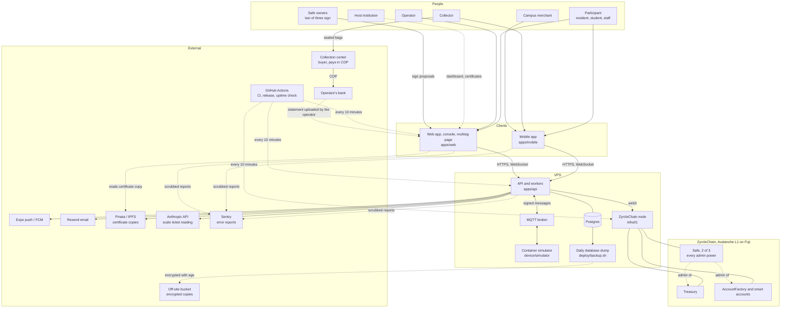

# Zyrcle architecture

> Status: **v1 blocks 1 and 2 and block 3 deployed** (2026-11-23): hosts and sites, collection,
> sale and settlement, the operator console, impact certificates, campus merchants, pilot readiness,
> and the foundations of block 3 (tests in CI, pinned deploys, monitoring, backups, rate limits,
> collection centers, ticket reading, bank statement matching, the Safe). Block 4 has started: M18
> and M19 (each deposit's steps, personal impact, where to spend, fill alerts, collector earnings)
> are built but not deployed; M20 to M23 are planned
> ([roadmap](roadmap-blocks-3-4.md)). The one-day hackathon build (May 2025) is preserved at tag
> `v0-hackathon`; how the project got here is in [history.md](history.md). Sections marked
> *planned* are not built yet. Step-by-step flows with diagrams: [flows.md](flows.md). Schema:
> [database.md](database.md). Servers and operation: [infrastructure.md](infrastructure.md).
> Endpoints: [api.md](api.md). Every decision: [adr/](adr/README.md).

## System at a glance



Dashed arrows are reads, checks, reports, copies and standing powers, not the main path. Sentry,
the off-site bucket and the Anthropic API are wired but stay off until their accounts exist
(section 12).

## 1. Problem

In Colombia, recycler organizations report the tonnage they recover to the national utilities
information system (SUI) every month, and that report decides how much they are paid through the
waste-collection tariff. The reported figures have been publicly questioned. Packaging producers
are also required to prove how much of their packaging was recovered (Extended Producer
Responsibility, Res. 1407/2018 and amendments).

Both problems need the same thing: **tonnage that can be verified from the source.** Zyrcle measures
recyclable material at the moment a household deposits it, follows it to the buyer, and pays the
household out of what the buyer actually paid.

## 2. Two mirrored chains

```
MATERIAL  deposit ──► container ──► collector bag ──► buyer's scale (collection center)
            grams        grams          grams             kg + COP/kg
                                                              │
MONEY     resident ◄── settlement ◄── treasury (L1) ◄── COP payment to the operator's bank
```

Every ZYR in circulation is backed by material that was weighed and sold, and by pesos that were
received.

## 3. Actors

| Actor | Role |
|---|---|
| Resident | Deposits material at a container and gets paid in ZYR, shown as Colombian pesos. Also called a participant: on a campus they are students and staff. |
| Host | The institution whose sites hold the containers: a university, a residential complex, a business ([ADR 0011](adr/0011-hosts-and-sites.md)). Gets a share of each sale and the impact certificates ([ADR 0027](adr/0027-impact-certificates.md)). |
| Container | Device with scale, fill sensor, metal sensor, camera, lock and a small display. Simulated until hardware exists. |
| Collector | Empties containers into bags tagged per material and delivers them to a collection center. |
| Collection center | Buys the material and pays the operator in COP. External party with its own scale. Zyrcle keeps a record of each one with its price per material, and each site sells to one ([ADR 0037](adr/0037-prices-per-collection-center.md)). |
| Operator | Runs Zyrcle from the console: reviews flagged deposits, sets up hosts, sites, centers and prices, records sales from the buyer's scale ticket, matches the bank statement, issues certificates, pays merchants out in pesos. |
| Campus merchant | A participant with the merchant role: charges in ZYR with a QR and redeems ZYR for pesos with the Treasury ([ADR 0029](adr/0029-closed-loop-payments.md)). |
| Safe owners | Three keys, two of which must sign every admin change on ZyrcleChain: Diego's Core wallet, his phone's MetaMask and a paper key ([ADR 0040](adr/0040-keys-guardian-and-multisig.md)). |

## 4. Components

| Path | Component | Notes |
|---|---|---|
| `apps/mobile` | Resident, collector and merchant app (Expo) | Scans the container's rotating QR, shows the live session, balance in COP, hourly turns, push notifications ([ADR 0008](adr/0008-push-notifications.md)). Embedded wallet: key in device secure storage, no seed phrase shown; the ZYR lives in a smart account the key controls, recoverable on a new phone through a verified email ([ADR 0010](adr/0010-smart-accounts-and-recovery.md)). Collectors empty containers into bags; participants pay merchants by scanning their QR; merchants charge and redeem ([ADR 0029](adr/0029-closed-loop-payments.md)). Sentry when its DSN is set, from the next Android build ([ADR 0033](adr/0033-error-reports-and-uptime.md)). |
| `apps/web` | Landing, dashboards, console, multisig page | The hackathon UI on real data: hosts' and sites' dashboards, the web resident flow, impact certificates checked in the browser against the chain and the IPFS copy, and `/console` for operators signed in by email code ([ADR 0014](adr/0014-operator-accounts.md)). Console tabs: summary with the health report, review queue, incidents, collection (collectors and bag labels), sales (the ticket photo, the bank statement, the settlement report), certificates, merchants and redemptions, hosts and sites, prices ("Centros de acopio" and the general table), and operators for admins. `/multisig` lets each Safe owner sign a proposal with a browser wallet ([ADR 0040](adr/0040-keys-guardian-and-multisig.md)). |
| `apps/api` | Backend (FastAPI + Postgres) | Deposit sessions, device link, verification, payouts, turns, push, lost-phone recovery, collections, collection centers and their prices, ticket scans, bank statements, sales and settlement, impact certificates, merchant payments and redemptions, operator accounts, health and alerts, rate limits, error reports; one worker per outbox. One module per responsibility, the tables in the `models/` package ([ADR 0036](adr/0036-module-boundaries.md)). The CLI (`zyrcle-api`) deploys contracts, makes keys and drives the Safe. |
| `device/simulator`, `packages/protocol` | Device protocol + simulator | Signed MQTT protocol ([spec](device-protocol.md)); the simulator speaks it exactly as firmware will. |
| `chain/` | Contracts | Treasury v3: mints ZYR only against recorded pesos; advances, settlements, collector and host parts, redemptions ([ADR 0007](adr/0007-on-chain-treasury.md), [ADR 0013](adr/0013-sale-and-settlement.md), [ADR 0029](adr/0029-closed-loop-payments.md)). AccountFactory and ZyrcleAccount: smart accounts with guardian recovery and signed calls ([ADR 0010](adr/0010-smart-accounts-and-recovery.md)). Safe v1.4.1, vendored unchanged in `chain/lib/safe-smart-account` ([ADR 0040](adr/0040-keys-guardian-and-multisig.md)). |
| `infra/l1` | ZyrcleChain v2 (live on Fuji) | Subnet-EVM L1 on Fuji, native coin ZYR, validator on the operator's VPS. `fuji.env` holds every address; `safe/` keeps each executed Safe proposal. |
| `deploy/` | Production stack | Docker Compose on the VPS: API, Postgres, Mosquitto, simulator, web, behind Traefik ([ADR 0020](adr/0020-single-vps-docker-compose.md)). `deploy.sh` runs images by digest, backs up before migrating and appends each deploy to `deploy/history.log` on the VPS ([ADR 0032](adr/0032-deploys-pinned-recorded-and-backed-up.md)). `backup.sh` (daily dump) and `offsite.sh` (encrypted copies off the VPS, [ADR 0034](adr/0034-encrypted-off-site-backups.md)). |
| `packages/client` | Shared TypeScript | API client, Sign-In with Ethereum, QR parsing, certificate check, the scrubbing of error reports and Spanish labels for web and mobile ([ADR 0024](adr/0024-monorepo-tooling.md)). |
| `e2e/` | End-to-end tests | Playwright journeys of every party against the whole system started from the commit's code, on every push and pull request ([ADR 0031](adr/0031-testing-and-the-pre-production-check.md), [README](../e2e/README.md)). |
| `.github/workflows` | CI, release, uptime | `ci.yml` (lint, tests, coverage floors, the end-to-end journeys, images), `release.yml` (images for commits whose CI passed, with their digests), `uptime.yml` (every 10 minutes from outside, [ADR 0033](adr/0033-error-reports-and-uptime.md)). |

## 5. Deposit session

One session per container at a time, enforced by the database. On top of that lock, hourly turns
spread residents over the day ([ADR 0009](adr/0009-time-slots.md)): each container takes a set
number of residents per hour, a booked spot is guaranteed, and residents without one get in while
the hour has room.

```
IDLE ─scan─► AUTHORIZED ─unlock─► OPEN ─first reading─► DEPOSITING ─"done" / idle timeout─► CLOSING
                                                                                            │
          PAID ◄─ advance minted ◄─ VERIFIED ◄─ score ≥ threshold ─ MEASURED ◄─ stable reading
                                       ▲                               │
                                       └──── operator approves ◄─ REVIEW (score < threshold)
```

Rules:

- The QR on the container rotates (short-lived nonce on the display). A photo of an old code is
  useless.
- The phone never talks to the container. The backend opens the lock over MQTT and streams live
  readings to the app over WebSocket.
- Deposited weight = stable reading after the lock closes − tare taken right before unlocking.
- Every device message is signed with the device key (secure element) and carries a sequence
  number. Unsigned, replayed or out-of-order messages are rejected.
- If the resident walks away without tapping "done", the session closes after an idle timeout and
  the measured weight is still credited.

## 6. Material verification

Cheapest signal first, combined into one confidence score:

1. **Density**: added weight ÷ added volume (ultrasonic fill sensor). A stone is roughly 25× denser
   than PET of the same volume.
2. **Inductive sensor** for metal.
3. **Camera + vision model**: checks the declared material and flags contamination.
4. **NIR** only if the budget allows. Polymer-grade NIR needs short-wave infrared sensors that cost
   hundreds to thousands of dollars.

High score: accepted automatically. Low score: goes to operator review. A deposit is never rejected
silently.

## 7. Collection and sale

Collection ([ADR 0012](adr/0012-collection-and-bags.md)), the sale with its settlement
([ADR 0013](adr/0013-sale-and-settlement.md)), collection centers
([ADR 0037](adr/0037-prices-per-collection-center.md)), reading the ticket from a photo
([ADR 0038](adr/0038-reading-scale-tickets-with-ai.md)) and matching the bank statement
([ADR 0039](adr/0039-bank-statement-matching.md)) are built.

- The container's own scale measures each emptying. Collectors do not declare weights.
- Collectors carry one bag per material, each with a QR. Emptying a container records
  "container C put N grams of material M into bag B": the collector scans the bag, takes that
  material out, and the bag gets the difference between two signed readings. What is not
  recyclable goes out as residue, weighed the same way. When the lid closes, the deposits made
  since the previous collection are linked to it.
- Each site sells to one collection center. A sale can name the center that bought.
- The sale of each bag is recorded from the buyer's scale ticket. Rollout levels:
  0. the operator photographs the ticket in the console, Claude (`claude-opus-5-5`) reads it into a
     fixed JSON shape, the API checks the arithmetic and proposes a sealed bag per line, and the
     operator corrects and records the sale (built; off without an Anthropic key, when the ticket
     is typed by hand). The photo, the reading, the model and who sent it are kept (`ticket_scan`);
  1. collection-center staff send the photo over WhatsApp (*planned*);
  2. the collection center's own portal (M22, *planned*) or a smart scale at the center using the
     same device protocol.
- A sale is **confirmed** only when the COP payment shows up in the operator's bank account. The
  operator uploads the bank's statement (CSV or Excel); the API proposes which credit pays which
  sale, and which debit pays which redemption, and the operator confirms each with one click. The
  bank reference can still be typed by hand. Nothing is confirmed automatically.

### Mass balance

| Hop | Expected | Tolerance |
|---|---|---|
| Container weight when a collection opens vs. what the previous one left plus every deposit since | equal (same scale) | the larger of 50 g and 2 % |
| What left the container vs. the bags and residue weighed | equal (same scale) | the larger of 50 g and 2 % |
| Grams put into a bag vs. buyer's weight for that bag | close: moisture and rejected material | the larger of 100 g and 5 % |

A breach opens an incident for the operator. Nothing is settled from a bag with an open incident.

## 8. Money

- **ZYR** is the native coin of ZyrcleChain. **1 ZYR = 1 COP.** On chain, 1e18 wei = 1 peso.
- Only the Treasury contract can mint (Subnet-EVM NativeMinter allow list, administered by the
  Safe), and only against a confirmed sale or a recorded seed-capital deposit.
- **Supply invariant:** ZYR in circulation (`minted − retired`) ≤ `backing`, the pesos received:
  seed capital plus the distributable part of each confirmed sale (the operations share stays in
  pesos), minus the pesos paid to merchants for their redemptions. Enforced in the contract and
  covered by invariant tests. The only ZYR that exists outside that rule is the **genesis float**:
  100 ZYR given to the L1 admin at genesis to pay gas, published in `infra/l1/params.env`.
- **Advance and settlement** (how cooperatives pay farmers):
  - On a verified deposit the resident gets an advance:
    `advance_ratio × reference_price(material) × kg`, capped per deposit and per resident per day,
    paid from the advance reserve.
  - When the bag is sold, the proceeds are split by shares fixed in the contract
    (residents / collector / host / operations: 65 / 15 / 10 / 10 by default). Each resident's part
    is pro rata to the grams traced from their deposits into that bag; each host's, to the grams
    that came from its sites.
  - Settlement = resident's part − advance already paid. Negative results are absorbed by the
    reserve and never clawed back from residents. `advance_ratio` is tuned from loss history.
- **Reference price** per material: the price of the collection center the deposit's site sells to;
  without one, or without a price for that material, the general table. The console suggests a
  center's price from the median COP per kilogram of its confirmed sales in the last 90 days, and
  the operator accepts it or types another; a suggestion never changes a price by itself
  ([ADR 0037](adr/0037-prices-per-collection-center.md)). Only the advance depends on it: the final
  payment follows the real sale.
- **Closed loop first** ([ADR 0004](adr/0004-closed-loop-first.md),
  [ADR 0029](adr/0029-closed-loop-payments.md)): residents pay campus merchants in ZYR by scanning a
  QR and signing with the phone, without gas; merchants redeem ZYR with the Treasury and the
  operator transfers the pesos (business-to-business, with the tax id checked on businesses only).
  A regulated ramp for residents comes later; ADR 0004 plans a `RampProvider` port for it, which is
  not in the code yet. Warp is enabled in the L1 genesis so the chain can bridge to C-Chain later
  without being rebuilt.

## 9. Keys and admin powers

[ADR 0022](adr/0022-keys-secrets-and-production-changes.md),
[ADR 0040](adr/0040-keys-guardian-and-multisig.md). Addresses in `infra/l1/fuji.env`.

| Key | Where | What it may do |
|---|---|---|
| Oracle | VPS key file | Treasury `ORACLE_ROLE`: advances (capped by the contract), residents' settlements, collector and host parts |
| Operator | VPS key file | Treasury `OPERATOR_ROLE`: recording seed capital and sales, the advance limits, settling or refunding redemptions. It also sends the certificate anchors |
| Guardian | VPS key file (`GUARDIAN_KEY_PATH`) | The AccountFactory's guardian: starts and cancels recoveries (48-hour wait), relays payments the phone signed, deploys accounts. It is still the oracle key until runbook 9.13 gives it its own |
| Safe, 2 of 3 | ZyrcleChain contract | Every admin power since 2026-11-23: the admin of the NativeMinter, ContractDeployerAllowList, FeeManager and RewardManager precompiles, the owner of the validator manager and of its proxy admin, and `DEFAULT_ADMIN_ROLE` of the Treasury and the AccountFactory. Each change is a proposal signed by two owners ([flow](flows.md#signing-a-safe-proposal)); executed proposals are kept in `infra/l1/safe/` |
| L1 admin | VPS key file | No power since the handover. It keeps the genesis float that pays gas for the backend's keys (runbook 9.12) and leaves the VPS once that float has another holder |
| P-Chain key | Key file (`zyrcle-pchain.pk`) | Signs P-Chain transactions, such as topping up the validator's balance. Not an EVM account, so it stays out of the Safe; ADR 0040 keeps it offline |

## 10. Operations

- **Health and alerts** ([ADR 0028](adr/0028-pilot-readiness.md)): the console's summary shows every
  outbox, devices online, the broker, the chain, the Treasury's mintable pesos and the gas of the
  hot keys; a worker emails admins each warning at most once a day. An old last block alone is a
  quiet chain, not a stalled one: the warning needs a transaction waiting as long too, and the
  report also asks the validator node itself (`/ext/health`).
- **Error reports** ([ADR 0033](adr/0033-error-reports-and-uptime.md)): the API, the web app and the
  mobile app send unhandled errors to Sentry, scrubbed first of emails, keys, signatures, tokens,
  request bodies, cookies and headers (`observability.py`, `packages/client/src/scrub.ts`). Off
  without a DSN.
- **Uptime from outside**: `.github/workflows/uptime.yml` checks every 10 minutes that the API
  answers and is connected to the broker, that the web app answers, and that the public RPC answers.
  A failure opens an issue labelled `uptime`; the next healthy check closes it.
- **Backups** ([ADR 0028](adr/0028-pilot-readiness.md),
  [ADR 0034](adr/0034-encrypted-off-site-backups.md)): a daily `pg_dump` on the VPS from cron, kept
  14 days, and a dump before every migration. `offsite.sh` encrypts the newest dump daily, and
  every Sunday the validator identity, the key files and `deploy/.env`, with `age` to a public key
  whose private half only Diego holds, then copies them to an S3-compatible bucket (Cloudflare R2)
  with `rclone`. Proven in CI against a stand-in bucket; off until the bucket exists.
- **Deploys** ([ADR 0032](adr/0032-deploys-pinned-recorded-and-backed-up.md)): images are published
  only for commits whose CI passed, the end-to-end journeys included; `deploy.sh` runs them by
  digest, refuses a checkout that is not the deployed commit, and records each deploy in
  `deploy/history.log`. Base images are pinned by digest and updated through Dependabot pull
  requests.
- **Rate limits** ([ADR 0035](adr/0035-rate-limits.md)): token buckets in the API process, per IP
  address for emailed codes and phone sign-in, per account (else per IP address) for writes and
  reads; a `429` carries `Retry-After`. Traefik limits each source address at the edge as well.

## 11. Units

| Quantity | Off chain | On chain |
|---|---|---|
| Weight | integer grams | `uint256` grams |
| Money | integer COP | wei-ZYR (1e18 = 1 COP) |

The hackathon build mixed three conventions (18-decimal "kg", grams and whole kg). That is gone.

## 12. External services

Each one is off without its key, and the rest of the system works without it.

| Service | Used for | Setting | In production |
|---|---|---|---|
| Expo push service, FCM | Push notifications ([ADR 0008](adr/0008-push-notifications.md)) | `ZYRCLE_PUSH_ENABLED` | on |
| Resend | Emailed codes, recovery notices, admin alerts ([ADR 0010](adr/0010-smart-accounts-and-recovery.md)) | `RESEND_API_KEY` | on |
| Pinata, IPFS | The permanent public copy of each impact certificate ([ADR 0027](adr/0027-impact-certificates.md), amendment) | `PINATA_JWT` | on |
| Anthropic API | Reading scale tickets from a photo ([ADR 0038](adr/0038-reading-scale-tickets-with-ai.md)) | `ANTHROPIC_API_KEY` | off until the key is placed |
| Sentry | Error reports ([ADR 0033](adr/0033-error-reports-and-uptime.md)) | `SENTRY_DSN_API`, `SENTRY_DSN_WEB`, `EXPO_PUBLIC_SENTRY_DSN` | off until the DSNs are set |
| Cloudflare R2 | Encrypted off-site backups ([ADR 0034](adr/0034-encrypted-off-site-backups.md)) | `OFFSITE_*` in `deploy/.env` | off until the bucket and the age key exist |
| GitHub Actions | CI, image release, the uptime check | `.github/workflows/` | on |

## 13. What is simulated

Only the hardware. The device simulator implements the real protocol, including signatures. When a
physical container exists, it replaces the simulator and nothing else changes. The tests also
replace the chain (anvil with a NativeMinter stand-in), Pinata, the IPFS gateway and the Anthropic
API with local stand-ins.

## 14. Not in scope yet

Block 4 ([roadmap](roadmap-blocks-3-4.md), *planned*): each deposit followed step by step, personal
impact and where to spend for participants; fill alerts and earnings for collectors; monthly PDF
certificates, goals and ranking data for hosts; an accounting export for merchants; a collection
center portal; a new Android build. Left out beyond that: collector route optimization, cash-out
for residents, tradable carbon or plastic credits, producer and SUI reports, iOS, the weighing
station hardware, and the chain for real money.
