# Flows

Each flow below is drawn from the code as it is. Participant = a resident, student or staff member
who recycles. Operator = a person running Zyrcle from the console. Container = the device with the
scale and sensors (simulated until hardware exists). Treasury = the contract that mints ZYR
(1 ZYR = 1 COP) on ZyrcleChain.

Every HTTP request in these flows, though not the live WebSocket, goes through the API's rate
limits (ADR 0035): too many in a minute get a `429` with `Retry-After`, and the apps say so in
Spanish.

- [Sign in](#sign-in)
- [Deposit](#deposit)
- [Advance priced by the site's center](#advance-priced-by-the-sites-center)
- [Booking a turn](#booking-a-turn)
- [Collection](#collection)
- [Sale and settlement](#sale-and-settlement)
- [From a ticket photo to a sale](#from-a-ticket-photo-to-a-sale)
- [Matching the bank statement](#matching-the-bank-statement)
- [Impact certificate](#impact-certificate)
- [Paying a campus merchant](#paying-a-campus-merchant)
- [Lost-phone recovery](#lost-phone-recovery)
- [Signing a Safe proposal](#signing-a-safe-proposal)
- [Push notifications](#push-notifications)
- [The money](#the-money)

## Sign in

The phone generates a key on first launch and keeps it in secure storage (ADR 0006). There is no
password and no seed phrase.

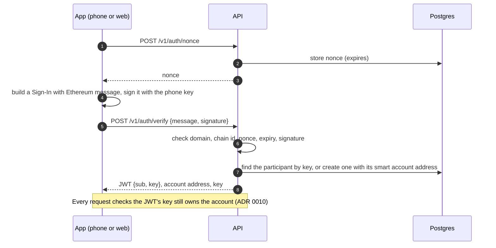

Operators sign in differently: a six-digit code sent to their email, then a JWT with
`role: operator` that lasts 8 hours (ADR 0014).

## Deposit

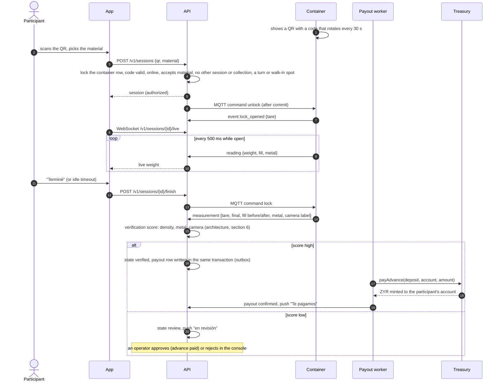

Every device message is signed with the container's key and carries a sequence number; unsigned,
replayed or out-of-order messages are dropped (`docs/device-protocol.md`). The advance's amount
depends on the price of the collection center the site sells to
([next flow](#advance-priced-by-the-sites-center)).

## Advance priced by the site's center

ADR 0037. Only the advance depends on this price; the final payment follows the real sale.

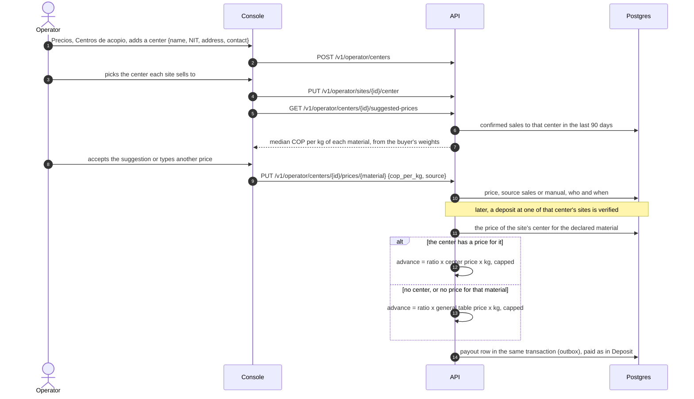

A suggestion never changes a price by itself. A sale can also name the center that bought, which
is what the next suggestions are computed from.

## Booking a turn

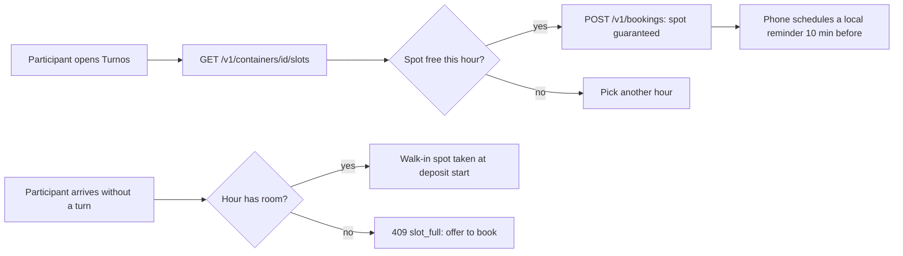

ADR 0009. Spots per container and hour, and opening hours, belong to the site (ADR 0011).

## Collection

ADR 0012. Nobody types a weight: the container's own scale weighs every bag.

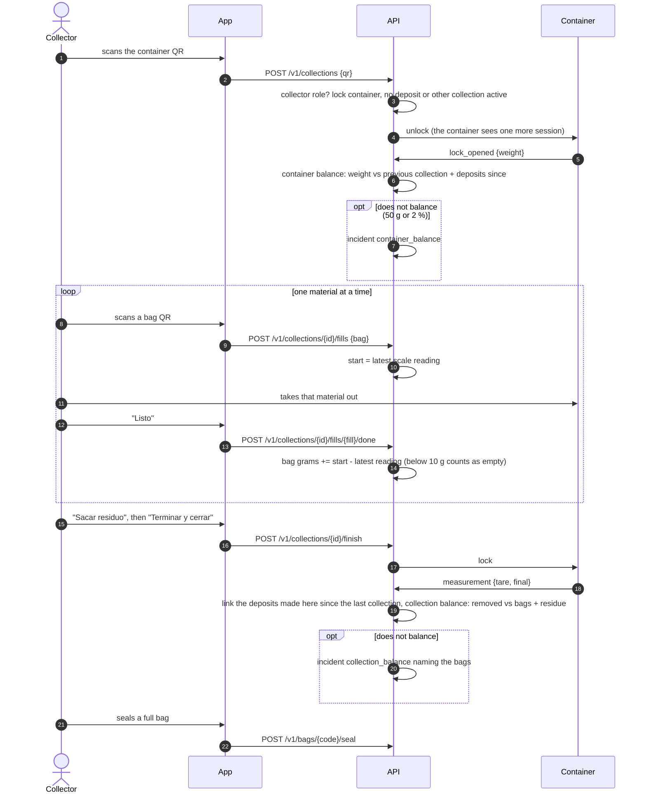

## Sale and settlement

ADR 0013. Nothing reaches the chain before the money reaches the bank. The ticket can be typed or
filled from a photo ([next flow](#from-a-ticket-photo-to-a-sale)), and the bank match can be typed
or confirmed from an uploaded statement
([matching the bank statement](#matching-the-bank-statement)).

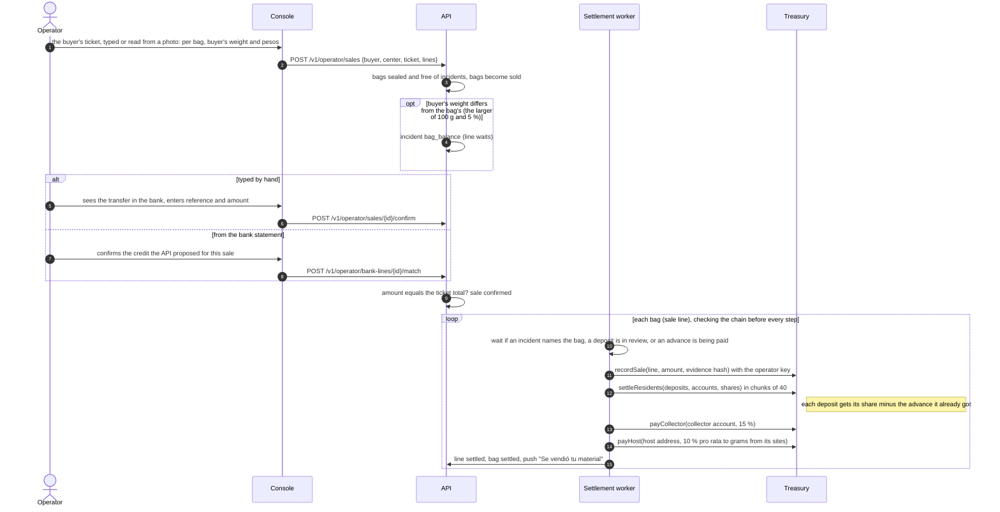

Shares: 65 % participants (pro rata to verified grams), 15 % collector, 10 % host, 10 % operations
(stays in pesos). A host without a payout address waits; its part is paid when it is set.
`recordSale` is signed with the operator key; the residents', collector's and host's parts with the
oracle key.

## From a ticket photo to a sale

ADR 0038. The model reads; the API checks and proposes; a person records the sale. Without an
Anthropic key the API answers `503` and the operator types the ticket.

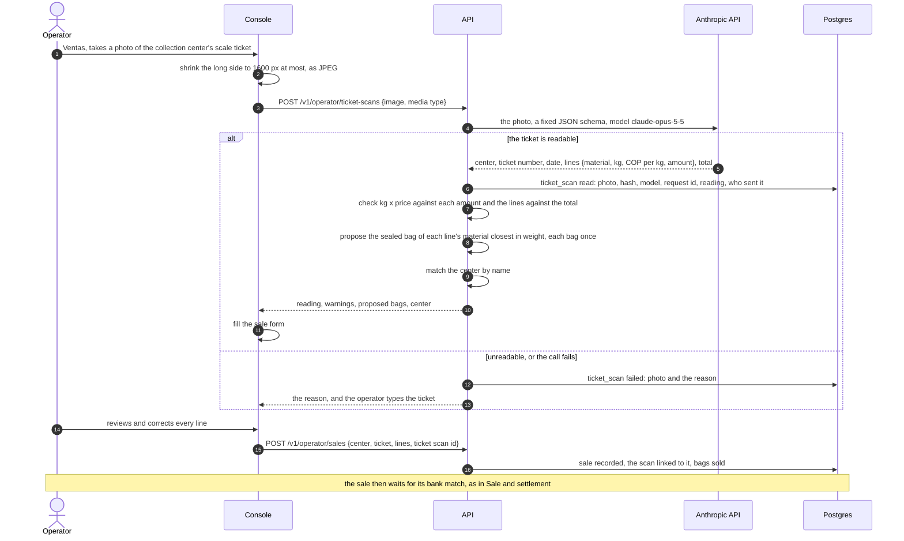

## Matching the bank statement

ADR 0039. The API proposes; nothing is confirmed until the operator clicks.

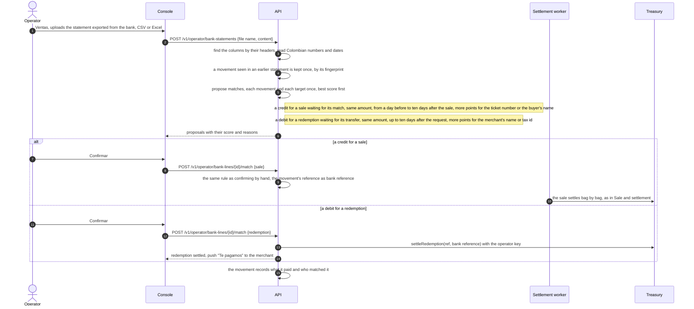

## Impact certificate

ADR 0027. Only material that reached a buyer counts, and each gram is claimed once. With Pinata
configured, a public copy is pinned on IPFS first and its CID goes on chain with the root
(amendment of 2026-11-22); without it, steps 6 and 7 and the IPFS reads are skipped and the data
starts with `ZYRCLE-CERT-1`.

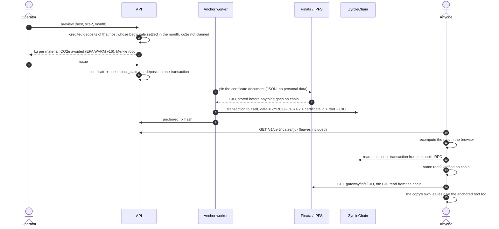

## Paying a campus merchant

ADR 0029. The participant needs no gas and no deployed account; the backend cannot change what was
signed.

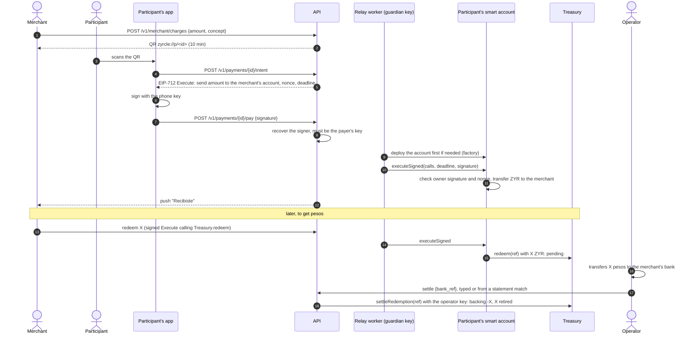

## Lost-phone recovery

ADR 0010. The balance never moves; only the key that controls the smart account changes.

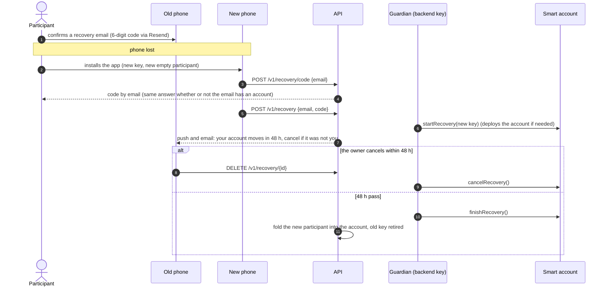

The guardian also relays signed payments. In production it is still the oracle key until runbook
9.13 gives it its own (ADR 0040); since the handover, naming a new guardian is a Safe proposal.

## Signing a Safe proposal

ADR 0040. Since 2026-11-23 a Safe with three owners (Diego's Core wallet, his phone's MetaMask and
a paper key) holds every admin power of ZyrcleChain, and two must sign each change. The handover
itself was signed this way: the proof that the Safe acts, then the removal of the admin key from
the precompiles, both kept in `infra/l1/safe/`.

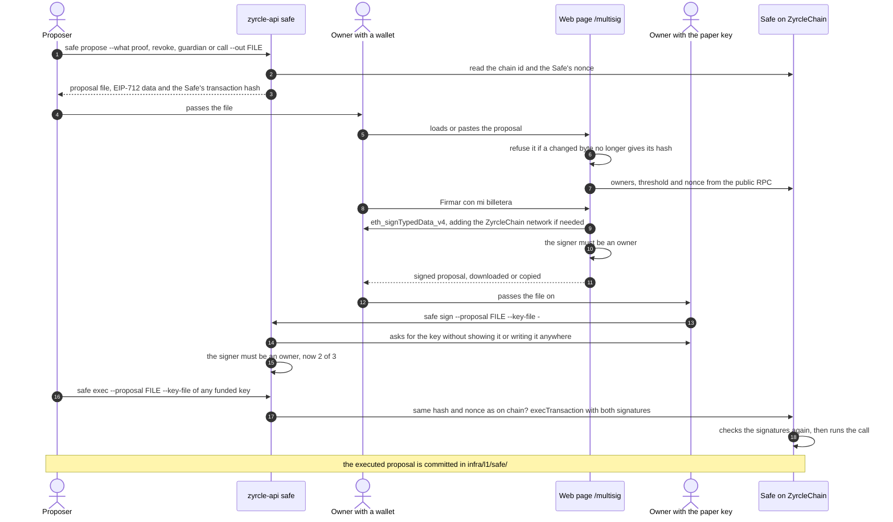

Either owner may sign first, on the page or on the command line.

## Push notifications

ADR 0008.

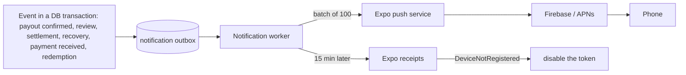

Turn reminders are not pushed by the server: the phone schedules them locally from its bookings.

## The money

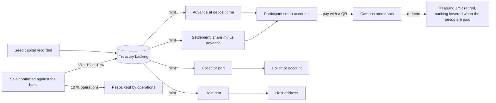

The Treasury refuses any mint that would put more ZYR in circulation (`minted - retired`) than
`backing` (ADR 0007, ADR 0029).
