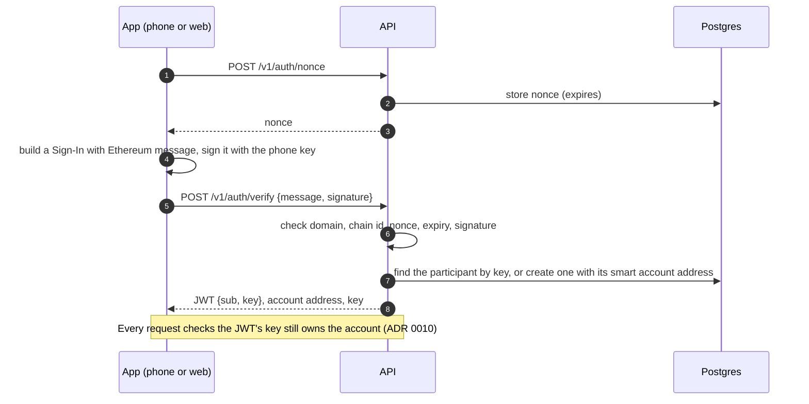
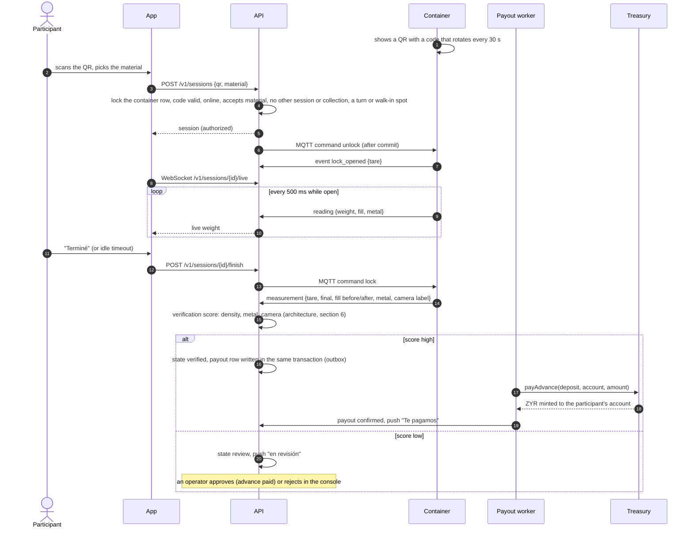
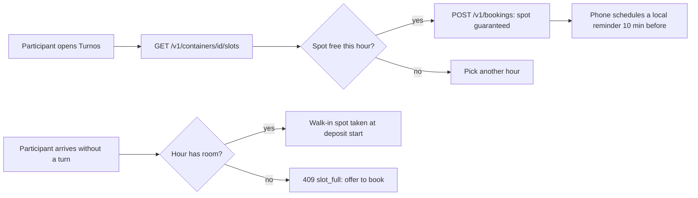
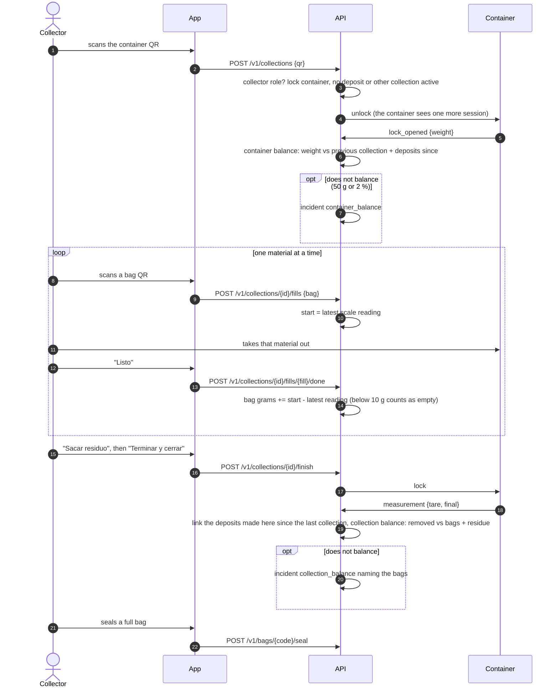
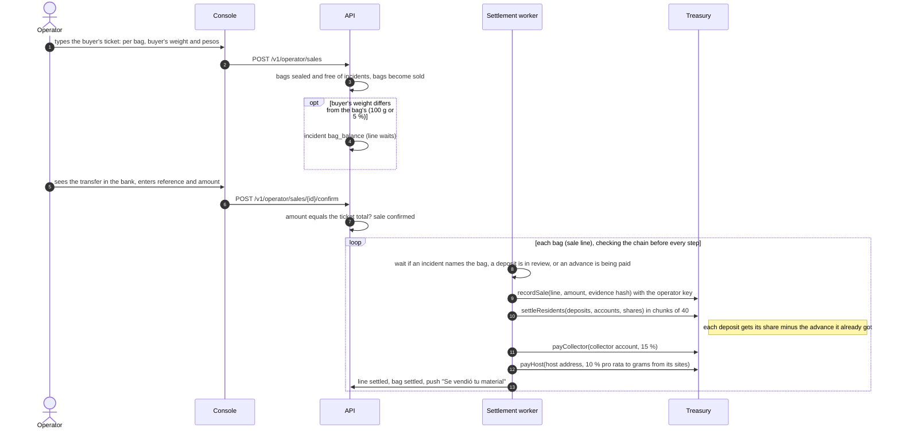
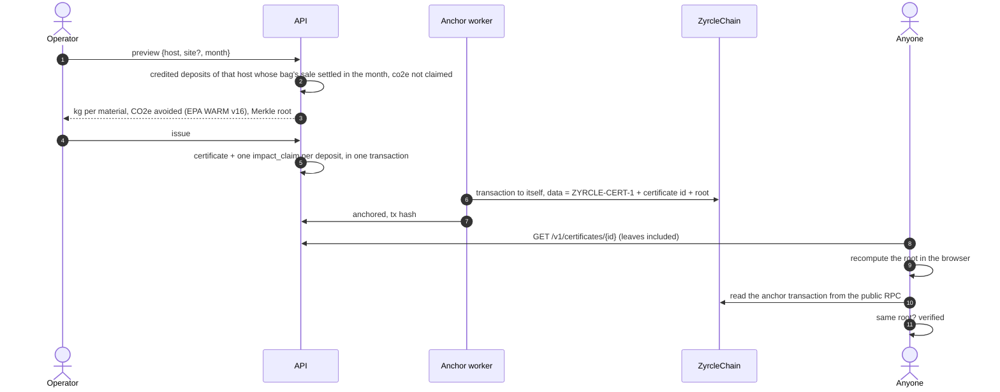
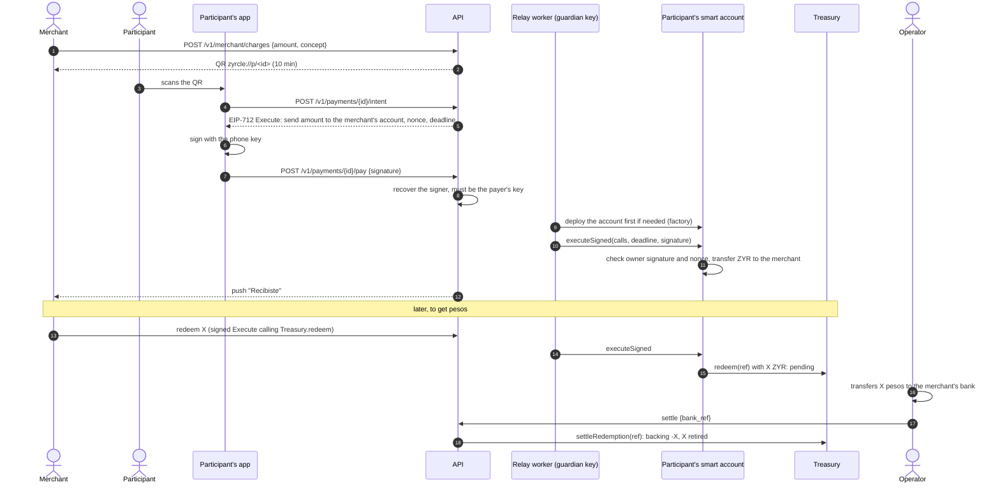
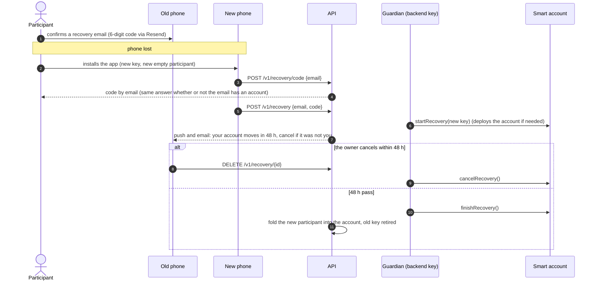
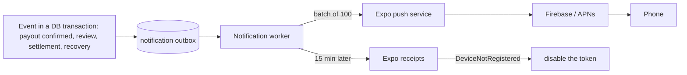
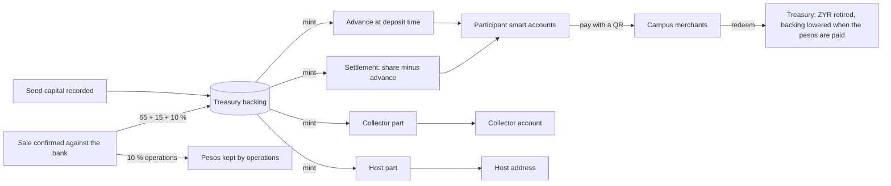

# Flows

Each flow below is drawn from the code as it is. Participant = a resident, student or staff member
who recycles. Operator = a person running Zyrcle from the console. Container = the device with the
scale and sensors (simulated until hardware exists). Treasury = the contract that mints ZYR
(1 ZYR = 1 COP) on ZyrcleChain.

- [Sign in](#sign-in)
- [Deposit](#deposit)
- [Booking a turn](#booking-a-turn)
- [Collection](#collection)
- [Sale and settlement](#sale-and-settlement)
- [Impact certificate](#impact-certificate)
- [Paying a campus merchant](#paying-a-campus-merchant)
- [Lost-phone recovery](#lost-phone-recovery)
- [Push notifications](#push-notifications)
- [The money](#the-money)

## Sign in

The phone generates a key on first launch and keeps it in secure storage (ADR 0006). There is no
password and no seed phrase.

Operators sign in differently: a six-digit code sent to their email, then a JWT with
`role: operator` that lasts 8 hours (ADR 0014).

## Deposit

Every device message is signed with the container's key and carries a sequence number; unsigned,
replayed or out-of-order messages are dropped (`docs/device-protocol.md`).

## Booking a turn

ADR 0009. Spots per container and hour, and opening hours, belong to the site (ADR 0011).

## Collection

ADR 0012. Nobody types a weight: the container's own scale weighs every bag.

## Sale and settlement

ADR 0013. Nothing reaches the chain before the money reaches the bank.

Shares: 65 % participants (pro rata to verified grams), 15 % collector, 10 % host, 10 % operations
(stays in pesos). A host without a payout address waits; its part is paid when it is set.

## Impact certificate

ADR 0027. Only material that reached a buyer counts, and each gram is claimed once.

## Paying a campus merchant

ADR 0029. The participant needs no gas and no deployed account; the backend cannot change what was
signed.

## Lost-phone recovery

ADR 0010. The balance never moves; only the key that controls the smart account changes.

## Push notifications

ADR 0008.

Turn reminders are not pushed by the server: the phone schedules them locally from its bookings.

## The money

The Treasury refuses any mint that would put more ZYR in circulation (`minted - retired`) than
`backing` (ADR 0007, ADR 0029).
