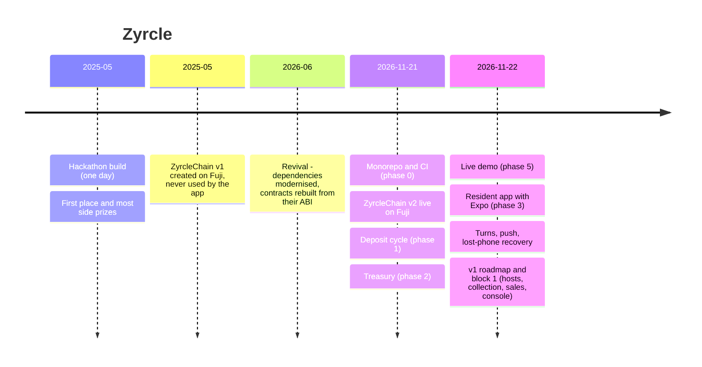

# History

How Zyrcle got from a one-day hackathon build to what is in this repository, with the decisions
taken at each step. Each decision since November 2026 has an [ADR](adr/README.md); the hackathon's
were never written down and are reconstructed here from the code at tag `v0-hackathon`.

## 2025: the hackathon

Built in one day (3 to 5 May 2025) by Diego's team, in two repositories (`zyrcle-frontend` and
`zyrcle-backend`). It won first place and most side prizes, for its technical depth.

**What it was.** A residence dashboard, a recycling page with QR scanning, a collectors' route map, a
marketplace of certificates and an event history, in React with Vite, Tailwind, shadcn/ui and 3D
models. The backend (FastAPI) answered with hard-coded data, except `POST /api/iot/contenedores`,
which wrote to a JSON file without authentication.

**Decisions of that build, reconstructed from the code** (none were recorded at the time):

| Decision | Where it shows | What happened to it |
|---|---|---|
| Avalanche, Fuji C-Chain (chain id 43113) for the contracts | `apps/web/src/lib/network.ts` | Replaced by the project's own L1 (ADR 0002) |
| Three contracts: ZyrcleToken (ERC-20), ZyrcleCertificate (ERC-721), ZyrcleCore | `contracts/`, `deployments.json` | Lost and rebuilt from their ABI in 2026; removed in the rebuild (ADR 0019) |
| An own L1, ZyrcleChain v1, created and converted to an L1 on 4 May 2025 | P-Chain records | Never used by the app; its validator stopped when its fee balance ran out |
| Carbon-credit certificates as NFTs, images on IPFS through Pinata | `VITE_API_PINATA_ENV` | The secret sat in a public `VITE_*` variable. The idea returns as impact certificates (roadmap M5), with their copy on IPFS through Pinata again (ADR 0027, amendment) and the key kept on the server |
| Route optimisation for collectors with Gemini | `apps/api/services/gemini.py` | Not carried over; route optimisation is out of v1 scope. The key was rotated |
| The container: scale, sensors and infrared to check the material, opened from the app at a booked turn | Pitch and design only | Never built. The rebuild simulates it with the same protocol a real one will use (ADR 0016) |

**Economic model, as Diego described it.** The money comes from selling the material to a collection
center, which pays per material and kilo. Those pesos enter the chain and fill the reward pool. The
2025 design stopped where the collector unloads at the collection center; nobody had worked out how
to close the chain from there.

## June 2026: revival

On 11 June 2026 Diego revived both repositories (commits `106095a`, `3842980`): modern dependencies,
a working QR scanner, a network guard for the wallet, contract addresses and ABIs in one place, and
the three contracts rebuilt from the frontend's ABIs with Hardhat and OpenZeppelin 5 and deployed to
Fuji. The backend moved to FastAPI with Pydantic v2 on Python 3.13. It still served mock data.

## 21 November 2026: the rebuild starts

- **Monorepo.** Both repositories imported with their history into one (ADR 0001), tagged
  `v0-hackathon` at the import point. Architecture document and first ADRs written (`278fe00`).
- **Phase 0, cleanup.** API security holes closed and weights returned as grams (`c6c3a6b`); the
  web app's generator leftovers removed and its broken flows fixed (`6b0bb27`); CI for API, web and
  contracts (`41d58f5`). Goal and approach: ADR 0016.
- **ZyrcleChain v2 on Fuji** (ADR 0002): genesis, validator container and runbook (`0a29a42`),
  P-Chain work with `platform-cli` because Avalanche CLI 1.9.7 broke against AvalancheGo v1.15
  (ADR 0021), live the same evening (`d5798be`). Chain id 20261121, native coin ZYR, 1 ZYR = 1 COP.
- **Phase 1, the deposit cycle** (`af6b0d3` to `7d788df`): the signed device protocol
  (`docs/device-protocol.md`, ADR 0005), a simulator that speaks it, and the deposit-session backend
  with Postgres and MQTT. The hackathon API moved to `apps/api-legacy`.
- **Phase 2, the Treasury** (ADR 0007, ADR 0003): a contract that mints ZYR only against recorded
  pesos, and the backend paying advances through an outbox (`f45fd93`, `dda7ab5`). Deployed on Fuji
  with 1,000,000 COP of simulated seed capital (ADR 0023, `5080e3e`).

## 22 November 2026

- **Phase 5, the live demo.** Production stack on the VPS, images by commit SHA, idempotent deploy
  script (ADR 0020, `ed642e8`). The hackathon web app, with its design kept (ADR 0018), wired to the
  new API (`6467976`). The minimal demo page and the legacy API removed (`9c0b705`), then the
  Hardhat contracts (`fa1f0d1`, ADR 0019). Proprietary license (ADR 0017).
- **Phase 3, the resident app.** `packages/client` shared by web and mobile (`018b6ca`, ADR 0024);
  the Expo app with an embedded wallet (`b38e1f2`, ADR 0006). Diego tested it in Expo Go on Android.
- **Turns and push** (`f06078f` to `29e783c`): hourly slots with walk-ins (ADR 0009) and push
  notifications through an outbox and Expo (ADR 0008).
- **Lost-phone recovery** (`9f4395e`, `6490d28`): smart accounts with a guardian and a 48-hour wait,
  identity proven by an email code sent with Resend (ADR 0010). AccountFactory deployed on Fuji
  (`bd757af`). Deployed to production with Diego's approval.
- **Android build** (ADR 0015): EAS project and Firebase for push (`0bff9b4`). The first APK
  re-registered its push token ten times a second, which made the app slow; fixed, and the APK
  shrank from 132 to 67 MB by dropping x86 code (`f01b8e5`).
- **v1 roadmap** (`90738d0`, ADR 0026): one university campus closing the loop, delivered in two
  blocks that Diego reviews. Hosts get a share of each sale and impact certificates; tradable carbon
  credits wait for v2.
- **Block 1** of v1, built and verified locally, then pushed:
  - M1, hosts and sites (`34db0fe`, ADR 0011);
  - M2, collection with bags weighed by the container (`65b83b2`, ADR 0012);
  - M3, sale, bank match and settlement with a host share (`0b3d2d8`, ADR 0013);
  - M4, operator accounts and the console (`51ebd58`, ADR 0014).
- **Documentation** as part of the code (ADR 0025): decision log with who decided each record
  (`2a40718`), decisions from before the log recorded as ADRs 0016 to 0024, this history, the
  flows, the API, the database and the infrastructure. Writing them turned up a dozen bugs and
  gaps, fixed the same day (migration `0009`, the settlement of advances paid by the first
  Treasury, the WebSocket key check, clearer errors).
- **Block 1 deployed** with Diego's approval: Treasury with the host share on Fuji, migrations
  `0005` to `0008`, the demo turned into a university with two campuses, Diego's console account.
  The fixes found while documenting followed (migration `0009`). The two original repositories
  were archived.

## 23 November 2026: block 2 of v1, built locally

- **M5, impact certificates** (`1dec632`, ADR 0027): monthly per host or site, sold material only,
  EPA WARM v16 factors, one claim per gram, the Merkle root anchored on ZyrcleChain and verified in
  the browser.
- **M7, pilot readiness** (`bce7113`, ADR 0028): backups with a restore check, health and email
  alerts, consent under Ley 1581 with the policy and terms as drafts, API docs off in production,
  Slither review ([security.md](security.md)).
- **M6, spending on campus** (`b393faa`, ADR 0029): merchants, QR payments signed by the phone and
  relayed without gas, redemptions of ZYR for pesos, and a Treasury with redemptions (to deploy).
- **Certificates on IPFS** (ADR 0027, amendment): Diego recalled that the 2025 project kept
  certificates on IPFS through Pinata and chose to bring that back. Each certificate is now pinned
  as a JSON document and its CID is anchored with the root, so it can be checked without Zyrcle.

## 23 November 2026: block 2 deployed

With Diego's approval, naming each step: the commits pushed to `main`; a database backup checked by
restoring it; Treasury v3 with redemptions deployed on ZyrcleChain
(`0xd7052201140224018b123ecFF7b83B4251790Aeb`) and the simulated seed recorded again; migrations
`0010` to `0013` and the images of `a3f395e` deployed; 20 ZYR of gas each for the oracle and operator
keys; the two earlier Treasuries taken off the NativeMinter allow list; the daily backup installed in
cron. Diego placed the Pinata JWT on the server himself.

## 23 November 2026: block 3 built and deployed

Diego asked for everything missing, for every party and for the engineering, in two large blocks
(ADR 0030). Block 3 was built the same day: every party's journey tested in a browser in CI (ADR
0031), deploys pinned by digest and backed up before migrating (0032), error reports and an uptime
check (0033), encrypted off-site backups (0034), rate limits (0035), modules split by responsibility
(0036), prices per collection center (0037), scale tickets read from a photo with Claude (0038), the
bank statement matched to sales and redemptions (0039), and the guardian's own key (0040). A false
"chain stalled" alert the night before led to a health check that tells a quiet chain from a
stalled one (ADR 0028, amendment). Diego confirmed every record, chose the multisig signers (his
MetaMask, his phone and a paper key) and authorized the merge and the deploy: commit `ac09179`,
migrations `0014` to `0016`, images pinned by digest and recorded in `deploy/history.log`.
The multisig code of M17 followed the same day with his approval (`48fd1d1`): the Safe contracts, the
`zyrcle-api safe` commands and the `/multisig` signing page. Diego then chose his three signers and
approved the handover: the Safe `0x607c011C6921eA75C1e38223a5E5514eDbA7E43b` holds every admin power of ZyrcleChain since 2026-11-23,
and the key that held them all has none.

## Where the old things are

| What | Where |
|---|---|
| The hackathon code, as imported | tag `v0-hackathon` |
| The two original repositories | `github.com/diegowritescode/zyrcle-frontend`, `zyrcle-backend`: archived on 2026-11-22, each with a notice pointing here |
| Hackathon contracts (2026 rebuild of them) | Fuji C-Chain, addresses in `contracts/deployments.json` at tag `v0-hackathon` |
| ZyrcleChain v1 (2025) | Fuji P-Chain, inactive |
| Treasury before the host share | `0xB843946A42F2791B8b932F8c0205C9D277E351B1` on ZyrcleChain v2, replaced on 2026-11-22 by `0xBc5035341C075CBd75508ff1a3a5EC0241e58201` (ADR 0013) |
| Treasury before redemptions | `0xBc5035341C075CBd75508ff1a3a5EC0241e58201`, replaced on 2026-11-23 by `0xd7052201140224018b123ecFF7b83B4251790Aeb` (ADR 0029). Both old ones are off the NativeMinter allow list |
