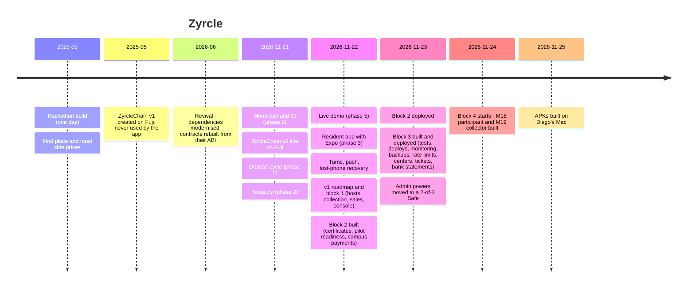

# History

How Zyrcle got from a one-day hackathon build to what is in this repository, with the decisions
taken at each step. Each decision since November 2026 has an [ADR](adr/README.md); the hackathon's
were never written down and are reconstructed here from the code at tag `v0-hackathon`.

## 2025: the hackathon

Built in one day (3 to 5 May 2025) by Diego's team, in two repositories (`zyrcle-frontend` and
`zyrcle-backend`). It won first place and most side prizes, for its technical depth.

**What it was.** A residence dashboard, a recycling page with QR scanning, a collectors' route map, a
marketplace of certificates and an event history, in React with Vite, Tailwind, shadcn/ui and 3D
models. The backend (FastAPI) answered with hard-coded data, except `POST /api/iot/contenedores`,
which wrote to a JSON file without authentication.

**Decisions of that build, reconstructed from the code** (none were recorded at the time):

| Decision | Where it shows | What happened to it |
|---|---|---|
| Avalanche, Fuji C-Chain (chain id 43113) for the contracts | `apps/web/src/lib/network.ts` | Replaced by the project's own L1 (ADR 0002) |
| Three contracts: ZyrcleToken (ERC-20), ZyrcleCertificate (ERC-721), ZyrcleCore | `contracts/`, `deployments.json` | Lost and rebuilt from their ABI in 2026; removed in the rebuild (ADR 0019) |
| An own L1, ZyrcleChain v1, created and converted to an L1 on 4 May 2025 | P-Chain records | Never used by the app; its validator stopped when its fee balance ran out |
| Carbon-credit certificates as NFTs, images on IPFS through Pinata | `VITE_API_PINATA_ENV` | The secret sat in a public `VITE_*` variable. The idea returns as impact certificates (roadmap M5), with their copy on IPFS through Pinata again (ADR 0027, amendment) and the key kept on the server |
| Route optimisation for collectors with Gemini | `apps/api/services/gemini.py` | Not carried over; route optimisation is out of v1 scope. The key was rotated |
| The container: scale, sensors and infrared to check the material, opened from the app at a booked turn | Pitch and design only | Never built. The rebuild simulates it with the same protocol a real one will use (ADR 0016) |

**Economic model, as Diego described it.** The money comes from selling the material to a collection
center, which pays per material and kilo. Those pesos enter the chain and fill the reward pool. The
2025 design stopped where the collector unloads at the collection center; nobody had worked out how
to close the chain from there.

## June 2026: revival

On 11 June 2026 Diego revived both repositories (commits `106095a`, `3842980`): modern dependencies,
a working QR scanner, a network guard for the wallet, contract addresses and ABIs in one place, and
the three contracts rebuilt from the frontend's ABIs with Hardhat and OpenZeppelin 5 and deployed to
Fuji. The backend moved to FastAPI with Pydantic v2 on Python 3.13. It still served mock data.

## 21 November 2026: the rebuild starts

- **Monorepo.** Both repositories imported with their history into one (ADR 0001), tagged
  `v0-hackathon` at the import point. Architecture document and first ADRs written (`278fe00`).
- **Phase 0, cleanup.** API security holes closed and weights returned as grams (`c6c3a6b`); the
  web app's generator leftovers removed and its broken flows fixed (`6b0bb27`); CI for API, web and
  contracts (`41d58f5`). Goal and approach: ADR 0016.
- **ZyrcleChain v2 on Fuji** (ADR 0002): genesis, validator container and runbook (`0a29a42`),
  P-Chain work with `platform-cli` because Avalanche CLI 1.9.7 broke against AvalancheGo v1.15
  (ADR 0021), live the same evening (`d5798be`). Chain id 20261121, native coin ZYR, 1 ZYR = 1 COP.
- **Phase 1, the deposit cycle** (`af6b0d3` to `7d788df`): the signed device protocol
  (`docs/device-protocol.md`, ADR 0005), a simulator that speaks it, and the deposit-session backend
  with Postgres and MQTT. The hackathon API moved to `apps/api-legacy`.
- **Phase 2, the Treasury** (ADR 0007, ADR 0003): a contract that mints ZYR only against recorded
  pesos, and the backend paying advances through an outbox (`f45fd93`, `dda7ab5`). Deployed on Fuji
  with 1,000,000 COP of simulated seed capital (ADR 0023, `5080e3e`).

## 22 November 2026

- **Phase 5, the live demo.** Production stack on the VPS, images by commit SHA, idempotent deploy
  script (ADR 0020, `ed642e8`). The hackathon web app, with its design kept (ADR 0018), wired to the
  new API (`6467976`). The minimal demo page and the legacy API removed (`9c0b705`), then the
  Hardhat contracts (`fa1f0d1`, ADR 0019). Proprietary license (ADR 0017).
- **Phase 3, the resident app.** `packages/client` shared by web and mobile (`018b6ca`, ADR 0024);
  the Expo app with an embedded wallet (`b38e1f2`, ADR 0006). Diego tested it in Expo Go on Android.
- **Turns and push** (`f06078f` to `29e783c`): hourly slots with walk-ins (ADR 0009) and push
  notifications through an outbox and Expo (ADR 0008).
- **Lost-phone recovery** (`9f4395e`, `6490d28`): smart accounts with a guardian and a 48-hour wait,
  identity proven by an email code sent with Resend (ADR 0010). AccountFactory deployed on Fuji
  (`bd757af`). Deployed to production with Diego's approval.
- **Android build** (ADR 0015): EAS project and Firebase for push (`0bff9b4`). The first APK
  re-registered its push token ten times a second, which made the app slow; fixed, and the APK
  shrank from 132 to 67 MB by dropping x86 code (`f01b8e5`).
- **v1 roadmap** (`90738d0`, ADR 0026): one university campus closing the loop, delivered in two
  blocks that Diego reviews. Hosts get a share of each sale and impact certificates; tradable carbon
  credits wait for v2.
- **Block 1** of v1, built and verified locally, then pushed:
  - M1, hosts and sites (`34db0fe`, ADR 0011);
  - M2, collection with bags weighed by the container (`65b83b2`, ADR 0012);
  - M3, sale, bank match and settlement with a host share (`0b3d2d8`, ADR 0013);
  - M4, operator accounts and the console (`51ebd58`, ADR 0014).
- **Documentation** as part of the code (ADR 0025): decision log with who decided each record
  (`2a40718`), decisions from before the log recorded as ADRs 0016 to 0024, this history, the
  flows, the API, the database and the infrastructure. Writing them turned up a dozen bugs and
  gaps, fixed the same day (migration `0009`, the settlement of advances paid by the first
  Treasury, the WebSocket key check, clearer errors).
- **Block 1 deployed** with Diego's approval: Treasury with the host share on Fuji, migrations
  `0005` to `0008`, the demo turned into a university with two campuses, Diego's console account.
  The fixes found while documenting followed (migration `0009`). The two original repositories
  were archived.

## 22 November 2026, evening: block 2 of v1, built locally

- **M5, impact certificates** (`1dec632`, ADR 0027): monthly per host or site, sold material only,
  EPA WARM v16 factors, one claim per gram, the Merkle root anchored on ZyrcleChain and verified in
  the browser.
- **M7, pilot readiness** (`bce7113`, ADR 0028): backups with a restore check, health and email
  alerts, consent under Ley 1581 with the policy and terms as drafts, API docs off in production,
  Slither review ([security.md](security.md)).
- **M6, spending on campus** (`b393faa`, ADR 0029): merchants, QR payments signed by the phone and
  relayed without gas, redemptions of ZYR for pesos, and a Treasury with redemptions (to deploy).
- **Certificates on IPFS** (ADR 0027, amendment): Diego recalled that the 2025 project kept
  certificates on IPFS through Pinata and chose to bring that back. Each certificate is now pinned
  as a JSON document and its CID is anchored with the root, so it can be checked without Zyrcle.

## 23 November 2026: block 2 deployed

Just after midnight, with Diego's approval, naming each step: the commits pushed to `main`; a
database backup checked by restoring it; Treasury v3 with redemptions deployed on ZyrcleChain
(`0xd7052201140224018b123ecFF7b83B4251790Aeb`) and the simulated seed recorded again; migrations
`0010` to `0013` and the images of `a3f395e` deployed; 20 ZYR of gas each for the oracle and
operator keys; the two earlier Treasuries taken off the NativeMinter allow list; the daily backup
installed in cron. Diego placed the Pinata JWT on the server himself.

## 23 November 2026: block 3 built and deployed

Diego asked for everything missing, for every party and for the engineering, in two large blocks.
Claude proposed the split and the order, and Diego confirmed it the same day (ADR 0030,
`e068f14`). The [roadmap](roadmap-blocks-3-4.md) has what each milestone built.

- **A quiet chain is not a stalled one** (`d69b62c`, ADR 0028, amendment). On the night of the
  block 2 deploy the alert "no block for 10 minutes" fired on a healthy chain: ZyrcleChain makes a
  block only when there is a transaction. The warning now needs work that has waited for the chain
  as long as the last block is old, and the health report asks the validator node itself
  (`/ext/health`).
- **Block 3, built in one session** (`a5e49fb` to `e328ac4`): every party's journey tested in a
  browser in CI (M8, ADR 0031), deploys pinned by digest and backed up before migrating (M9,
  0032), error reports and an uptime check (M10, 0033), encrypted off-site backups (M11, 0034),
  rate limits (M12, 0035), modules split by responsibility (M13, 0036), prices per collection
  center (M14, 0037), scale tickets read from a photo with Claude (M15, 0038), the bank statement
  matched to sales and redemptions (M16, 0039), and the guardian's own key with the multisig
  designed (M17, 0040).
- **Block 3 deployed.** Diego confirmed every record, said who would sign the multisig (his
  MetaMask, his phone and a paper key) and authorized the merge and the deploy (`ac09179`):
  migrations `0014` to `0016`, images pinned by digest and recorded in `deploy/history.log`.
- **The multisig code** followed the same day with his approval (`48fd1d1`): Safe v1.4.1, the
  `zyrcle-api safe` commands and the web app's `/multisig` signing page.
- **The handover** (`fd05fa7`, ADR 0040, amendment). With his approval the Safe
  `0x607c011C6921eA75C1e38223a5E5514eDbA7E43b` was deployed on ZyrcleChain with his Core wallet,
  his phone's MetaMask and a paper key, threshold two. He signed both proposals, with Core on the
  multisig page and with the paper key on the command line. Since 2026-11-23 the Safe holds all
  eight admin powers of ZyrcleChain, and the L1 admin key that held them all has none. The signed
  proposals are kept in `infra/l1/safe/`.
- **A lost lid-open update** (`c2e0d67`, 2026-11-24). The browser journey in CI caught the deposit
  page stuck on "Abriendo la tapa…". The session's live socket read the state and only then
  subscribed to updates, so a lid that opened in between was announced to nobody, and the page,
  which only polls while the socket is down, waited forever. The socket now subscribes first. A
  test races a change against every read; with Diego's approval it was deployed the same night.

## 2026-11-24 and 25: block 4 starts

Diego asked what code was left and chose to start block 4 with the two parties who use Zyrcle every
day in the pilot: "listo, empieza con eso" (2026-11-24).

- **M18, the participant** ([ADR 0041](adr/0041-participant-timeline-impact-and-where-to-spend.md)).
  Each deposit shows its steps from the lid to the settlement: deposited, verified, advance,
  collected, sold (to whom) and paid (how much on top of the advance). A push when the material is
  sold, and the existing one when the share is paid. "Mi impacto" counts verified and sold kilograms
  and the CO2e of what was sold, with the certificates' factors. Merchants got a campus, a place,
  hours and what they sell, and a public list: "Dónde gastar" on the web and in the app.
- **M19, the collector** ([ADR 0042](adr/0042-collector-fill-alerts-and-earnings.md)). Collections
  keep the fill sensor's reading, so an emptied container no longer shows full (the site dashboard
  had that bug). A push to the host's collectors when a container passes 80 %, once until it is
  emptied; collectors may belong to one host. The collection screen lists the containers fullest
  first and what each collection paid, split among the collections that filled each bag.
- Migration `0017`. 130 backend tests and the 19 browser journeys pass, which now check the steps
  after a sale, the impact, the collector's board and the merchant in "Dónde gastar".
- **Decisions confirmed** on 2026-11-25 ("si, confirmo, documenta todo"): a deposit counts as sold
  when the ticket is recorded, since a recorded sale cannot be deleted; no second push when the
  advance already covered the share; personal CO2e only on what was sold and called indicative; one
  fill alert per container until it is emptied; collectors without a host see every host; a bag's
  collector share split by grams; merchants' place and hours as free text.
- Built on the branch `block4-m18-m19`, not deployed yet. The app's changes reach phones with the
  next Android build (M23).

Still waiting for Diego: the Sentry account, the backup bucket and its `age` key, the Anthropic
key, the guardian's own key (runbook 9.13), a new Android build, the legal review, Google Play and
the chain for real money. M20 to M23 of block 4 are planned.

## 2026-11-25: APKs built on the Mac

Diego asked to build the APKs on his Mac, reusing what his other Expo project does there: "quiero
que compilemos nuestros propios apks aqui en la mac". The Mac already had the toolchain (Java 21,
Android's command-line tools, the SDK and the NDK). The other project calls Gradle directly and
signs with Android's debug key; Zyrcle cannot, because the APKs on the phones carry the key Expo
keeps, Android installs updates only with the same key, and uninstalling would erase each phone's
key. So the build runs EAS's own runner on the Mac (`eas build --local`), which fetches Expo's key
for the duration of the build ([ADR 0043](adr/0043-android-builds-on-the-mac.md), proposed).

The first build took about 8 minutes and gave a 68 MB APK, signed with the same key as the last
cloud APK. Its own check said the Firebase app ID was missing when it was there: `aapt2 … | grep
-q` under `pipefail` fails when grep stops reading early. The checks now read each tool's output
whole, and were tried on the local APK, the last cloud APK and a copy signed with the debug key,
which they refuse. That APK includes M18 and M19, so it waits for the backend deploy.

## Where the old things are

| What | Where |
|---|---|
| The hackathon code, as imported | tag `v0-hackathon` |
| The two original repositories | `github.com/diegowritescode/zyrcle-frontend`, `zyrcle-backend`: archived on 2026-11-22, each with a notice pointing here |
| Hackathon contracts (2026 rebuild of them) | Fuji C-Chain, addresses in `contracts/deployments.json` at tag `v0-hackathon` |
| ZyrcleChain v1 (2025) | Fuji P-Chain, inactive |
| Treasury before the host share | `0xB843946A42F2791B8b932F8c0205C9D277E351B1` on ZyrcleChain v2, replaced on 2026-11-22 by `0xBc5035341C075CBd75508ff1a3a5EC0241e58201` (ADR 0013) |
| Treasury before redemptions | `0xBc5035341C075CBd75508ff1a3a5EC0241e58201`, replaced on 2026-11-23 by `0xd7052201140224018b123ecFF7b83B4251790Aeb` (ADR 0029). Both old ones are off the NativeMinter allow list |
| ZyrcleChain's admin powers before the Safe | Held by the single L1 admin key until 2026-11-23; since then by the 2-of-3 Safe `0x607c011C6921eA75C1e38223a5E5514eDbA7E43b`, with the signed handover proposals in `infra/l1/safe/` (ADR 0040) |
